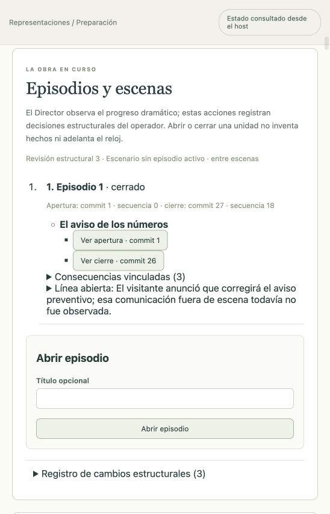

# Cierre del ensayo y diagnóstico de preflight

15 de octubre de 2026. Continúa la [evidencia live](llamadas-sin-limite.md), sin declarar terminados el objetivo general ni los 77 requisitos del producto.

## Cierre estructural

El ensayo alcanzó una resolución narrativa, pero una operación `closeScene` era rechazada porque el guard de `applyDramaticStructureCommand` encontraba generaciones históricas bloqueadas. Un retry aceptado conservaba correctamente ese historial; el guard lo confundía con trabajo pendiente.

La consulta ahora considera sólo la generación más reciente de cada job, identificada por corrida, actor y job. Conserva el bloqueo ante una generación vigente en `queued`, `running` o `blocked`, y conserva las filas históricas y las negativas idempotentes anteriores. La corrección no cancela turnos ni transforma un fallo en una actuación exitosa.

La regresión [dramatic-job-gate.test.ts](../../tests/dramatic-job-gate.test.ts) ejecuta SQLite, claim, fallo, retry, tool actoral, revisión y commit reales del host con transporte Pi sintético. Comprueba que el trabajo vigente impide el cierre, que el retry aceptado lo permite y que la generación bloqueada anterior permanece intacta. También comprueba que repetir una negativa ya registrada conserva su resultado; se utiliza una operación nueva tras resolver el impedimento.

En la interfaz real se verificó sobre `5913e9db-53e6-436f-8dc2-c2395186a6d1`:

- Escena cerrada: revisión estructural 2, commit 26, secuencia 18.
- Episodio cerrado: revisión estructural 3, commit 27, secuencia 18.
- Tres eventos de consecuencia vinculados: evaluación de Hymie, respaldo de Max y aceptación del visitante.
- Línea abierta con evidencia: el visitante anunció que corregiría el aviso; no se observó esa comunicación fuera de escena.
- Representación detenida mediante el control gráfico, conservando historia.

La [transcripción](../representaciones/la-alarma-de-los-numeros.md) conserva las 18 intervenciones, incluidas las repeticiones. El cierre fue decisión estructural del operador basada en lo ocurrido; no fue un acto autónomo del Director ni un cambio de estado de los objetivos privados.

El primer cierre reveló otra brecha: el índice dependía de etiquetas de la escena activa y mostraba UUID al quedar entre escenas. La proyección pública de estructura ahora incluye sólo id/nombre desde el snapshot confirmado del mismo corte, separada del schema durable y de sus hashes. La interfaz conserva el nombre al reabrir y consultar historia; el HTTP y los tests prueban que una escena posterior no aparece en un corte anterior. Se verificó en navegador después de reiniciar: «El aviso de los números» aparece tanto en el índice cerrado como en el commit histórico 26. La captura corresponde a la interfaz corregida.

## Preflight con acceso vencido o futuro

El evaluador ya clasificaba el acceso como diferido cuando el comprobante no cubría la fecha evaluada. Sin embargo, el broker adjuntaba ese comprobante como prueba actual y el journal rechazaba el guardado del propio informe bloqueado, exponiendo `evaluation-failed`.

El broker ahora conserva proveedor y huellas observadas, pero adjunta un comprobante sólo si `checkedAt` pertenece a su intervalo de vigencia. Los informes bloqueados quedan guardados con diagnóstico legible y sin falsa prueba de acceso. La admisión de ejecución conserva sus comprobaciones: un informe aprobado sin prueba, con prueba vencida o con prueba futura sigue rechazándose.

Las regresiones de [jobs](../../tests/run-preflight-jobs.test.ts) y [journal](../../tests/run-preflight-journal.test.ts) usan host, persistencia y credencial/probe sintéticos, sin proveedor externo. Prueban vencimiento, fecha futura, conservación del comprobante histórico y rechazo de falsos resultados aprobados. El nuevo diagnóstico no se ha reproducido manualmente con una cuenta real vencida después de la corrección; la evidencia de esa reparación es la integración automatizada real del host.

## Validación y alcance

- Pruebas focales de estructura/HTTP/journal: 55 aprobadas; regresión ampliada con un sucesor que vuelve a bloquearse, aprobada.
- Proyección de nombres, interfaz y bifurcación: 18 pruebas afectadas aprobadas con ICM real, sin omisiones.
- Pruebas focales de preflight: 26 aprobadas.
- `npm run verify`, con CLI ICM 0.11.4 real: 1245 tests, 1244 aprobados, cero fallos y una omisión por plataforma.
- `npm run build` aprobado; `git diff --check` limpio. La última verificación global incluye las etiquetas y el consumidor HTTP de bifurcación corregido.
- Revisión independiente de cierre/preflight: sin hallazgos bloqueantes y 27 pruebas reejecutadas aprobadas. La nueva regresión focal usa un actor; el recorrido gráfico acredita cierre de episodio del ensayo con Max y Hymie.

Estas regresiones prueban las correcciones descritas. No acreditan recepción humana dirigida, fidelidad audiovisual, login Anthropic/ElevenLabs, recuperación integral ni todas las superficies del PRD. El objetivo general fue reactivado expresamente en la continuación posterior al handoff histórico y sigue activo.
