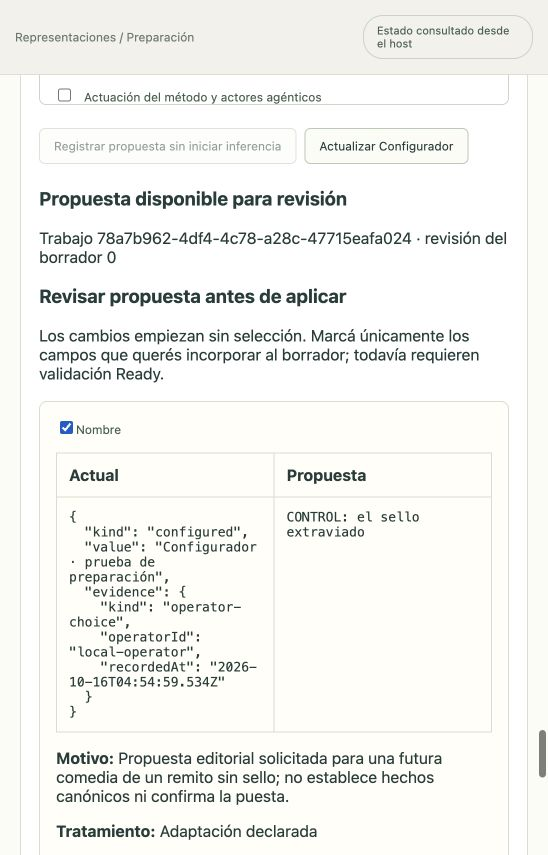
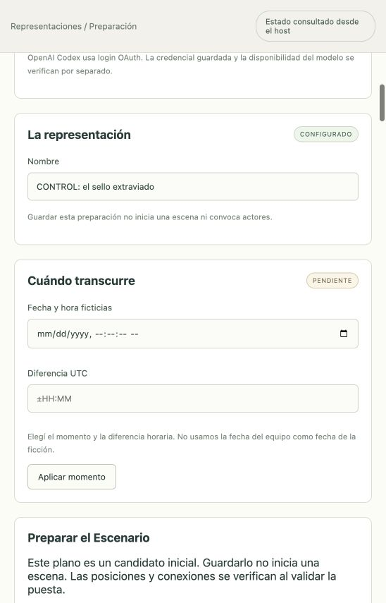

# Configurador antes de Ready

Corte de implementación: 16 de octubre de 2026 UTC. Continúa el [diseño acordado](../diseno/configurador-preparacion.md). Esta evidencia se refiere al Configurador de preparación; el Configurador de evolución de identidades conserva su recorrido separado.

## Comportamiento implementado

Un borrador guardado e incompleto puede registrar un pedido con expedientes concretos, documentos del manifiesto, perfil, presupuesto y snapshot ICM admitido. Registrar o consultar no inicia inferencias. El operador inicia explícitamente el trabajo y luego revisa las diferencias, motivos, referencias, adaptaciones, vacíos y contradicciones. Ningún cambio aparece seleccionado por defecto.

El Configurador utiliza una sesión Pi administrativa nueva y su contrato ICM propio. Su única herramienta presenta una propuesta estructurada de puesta, nueve secciones de curación por actor y ubicaciones. No recibe herramientas de actuación o de desarrollo, ni los contratos Markdown de otras audiencias. El host comprueba OAuth y el recibo de acceso del perfil elegido antes de crear la sesión y de cada despacho; estos controles no ejecutan un sondeo nuevo.

Aplicar es otra operación explícita: sólo los campos elegidos pasan al borrador, con CAS, historial y recibo durable. La autoría, fecha y adaptaciones de aceptación se generan en el host. El modelo no elige presupuesto, perfil, contexto ICM ni identidad humana. Las citas de documentos generales no se convierten en evidencia del expediente o en conocimiento actoral por aparecer en la propuesta.

Se pueden aceptar secciones actorales por separado. `roster.preparationDrafts` conserva curaciones incompletas sin habilitar sesiones actorales; `prepareCharacter` sólo publica un contexto completo y válido. Un actor no puede coexistir como preparado y pendiente en la misma preparación. Cambiar continuidad no reetiqueta procedencias anteriores. El editor conserva los parciales al cambiar el reparto y muestra cuántos siguen pendientes.

La propuesta no fabrica propiedades físicas para materializar inventario ni una configuración de audio completa a partir de «habilitado». Si faltan esas elecciones, la aplicación de esa selección se rechaza y el operador puede completar la configuración o elegir otras secciones.

## Persistencia y recuperación

Journal v44 agrega autoridad de presupuesto antes de Ready, trabajos del Configurador de preparación, operaciones idempotentes y registros inmutables de sesión, checkpoints, candidato y prueba terminal. Los paquetes `preparation-cut` permanecen dentro del trabajo; no se crean WorldRun, memorias actorales ni escenas ficticias para satisfacer claves de persistencia.

Los contadores compartidos conservan llamadas y tiempo al editar y llegar a Ready. `null` sigue significando sin tope de llamadas o tiempo acumulado. Concurrencia, timeout por solicitud y rechazo ante consumo incierto siguen vigentes.

La aceptación de una propuesta exige cadena JSONL real de Pi, perfil exacto, llamada a la herramienta correspondiente y reservas liquidadas. La relectura comprueba esa evidencia física. Un borrador cambiado invalida el trabajo anterior. Cancelación, cierre y reinicio no reanudan inferencias automáticamente. Recuperar una operación ya aplicada consulta su recibo durable antes de depender de la sesión física.

El respaldo suspende y drena al Configurador, conserva las sesiones registradas y exige archivos físicos cuando existen checkpoints que los necesitan. La compatibilidad de esquema histórica se mantiene; esta conexión no acredita la aceptación ampliada de transferencia entre máquinas.

## Verificación y límites

Hay pruebas con SQLite, SDK Pi y JSONL reales, transporte controlado, rutas HTTP y React montado. El caso integrado llega de borrador incompleto a Ready y conserva consumo. Además se ejecutó el siguiente recorrido real en navegador; su alcance es una propuesta de nombre, no una curación completa del reparto.

La función real [El paquete equivocado](../representaciones/el-paquete-equivocado.md) y su [guion exportado](exportacion-guion.md) se ejecutaron antes de este Configurador; no acreditan que éste haya preparado aquella función. Sigue pendiente la aceptación integral de los criterios del producto.

## Recorrido real en el host local

Desde la interfaz se creó el borrador `6c6d2a1e-2572-4677-a4f1-ad31e13a2b4f`, sin reparto, fecha, continuidad ni WorldRun; se configuraron llamadas y tiempo acumulado sin tope, concurrencia 1 y timeout por solicitud 30.000 ms. Se seleccionaron únicamente `process` y `cierre` de `role.configurator`, snapshot `4be3db955581af55ec1cc794e6abe8ff8cdc87f848531ae38d6779242d9e568f`. No se eligieron expedientes ni documentos adicionales.

El primer intento, `17e7fcb6-1c4b-4bff-91e6-4cea7d721075`, quedó bloqueado antes del transporte: había confundido la hoja de metadatos iniciales de Pi con un checkpoint comprometido. Se conservó el intento y se corrigió el contrato de sesión nueva a base nula, sin relajar la prueba física. La regresión usa `createPiSession` real, OAuth sintético y transporte controlado; también se corrigieron los otros workers administrativos nuevos con el mismo patrón.

Se comprobó explícitamente el acceso OAuth de OpenAI Codex, perfil `gpt-6.1-sol` / `low`, a las 04:55:31.230 UTC. Registrar el nuevo trabajo no infirió. Se pulsó Iniciar para el job `78a7b962-4df4-4c78-a28c-47715eafa024`: **dos requests completadas, 6653 ms medidos, cero spans pendientes**, candidato y prueba terminal aceptados. La lectura inicial de la propuesta expuso un error de proyección interna/pública; se corrigió y se recuperó la misma propuesta después de reiniciar, sin volver a llamar al modelo. Una regresión atraviesa el runtime compuesto y GET HTTP real para verificar la respuesta pública.

La propuesta mostró el nombre «CONTROL: el sello extraviado», motivo de adaptación editorial y preguntas abiertas sobre reparto, fecha, continuidad, documentos y ubicaciones. El botón Aplicar empezó deshabilitado. Se seleccionó únicamente Nombre y se aplicó desde GUI: revisión 1, historial 0–1, sin crear WorldRun ni escena ni actor, manteniendo los demás vacíos.

Recibo: candidato `a11966f9-e08f-44a9-bdd9-f656ec066f34`, hash de propuesta `14934c4d1f4620098e12149ae4e71f7cee017b302e2ee03264079c7956a74606`, hash de selección `1b82c92fe821c61628bb3b859021ad72afbacc2aca708ee72b68c8dc79a9b5c0`, borrador resultante `f90dc550991dd615cfc5bec07af1284583f156b485e836edd2e6031e24ffdfcb`. La revisión 1 continúa siendo una preparación incompleta, no una representación ejecutada.

Falta aceptación real del Configurador sobre todas las secciones de una puesta, curación de actores y posterior ejecución; el ensayo de nombre no la sustituye. Tampoco acredita Anthropic ni audio. El objetivo integral sigue activo.

## Cierre de verificación de este corte

`npm run verify` con ICM 0.11.4 real: **1448 pruebas, 1447 aprobadas, cero fallos, una omitida por plataforma**. Incluye la regresión del runtime público y la fábrica Pi real tras las correcciones detectadas en navegador. Build aprobado; persiste el aviso de un chunk de interfaz mayor de 500 kB. Revisión independiente, tipos y `git diff --check` aprobados. Los cambios permanecen locales sin commit/push. La comparación del historial privado confirmó que sólo cambiaron `name` y `revision`; las demás secciones conservaron sus bytes canónicos.
