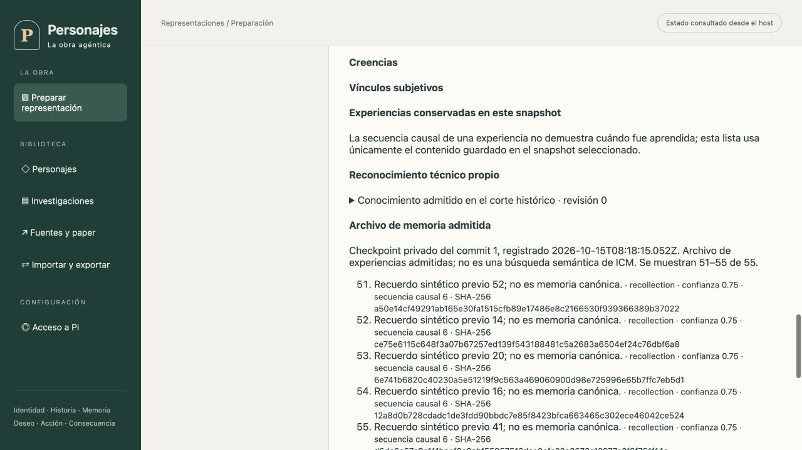

# Cortes privados: evidencia del corte 43

Fecha: 15 de octubre de 2026. Implementación parcial de UI-05, MEM-02/03/04/05 y prerrequisito de ESC-10. El objetivo integral y sus 77 requisitos siguen pendientes de aceptación.

## Problema y contrato

El snapshot conserva la mente confirmada del personaje, pero las entregas mecánicas y el reconocimiento técnico se almacenan también fuera de él. Una experiencia puede aceptarse después de un commit y conservar su misma secuencia causal. Filtrar la base actual por `worldSeq` atribuiría información futura al pasado. El [ADR 0010](../adr/0010-cortes-privados-exactos.md) y la [entrevista](dialogo-cortes-privados.md), con [respuestas del custodio](cortes-privados-respuestas.md), fijan el corte exacto sin sustituir elecciones del usuario.

## Implementación

La migración v34 crea `actor_state_cut_batches` y `actor_state_cuts`, sin rellenar cortes antiguos. La transacción captura el corte inicial después de registrar el conocimiento real y cada commit nuevo después de sus escrituras privadas. Incluye todos los personajes del snapshot, aun ausentes de escena o sin conocimiento registrado; ausencia de registro no equivale a conocimiento vacío. La preparación editable reemplaza únicamente su corte inicial junto con la configuración/snapshot; replay de una operación no recaptura memoria.

Cada lote vincula corrida, commit, revisión/secuencia, hash del snapshot y revisión/hash de configuración. Conserva un manifiesto completo de personajes y hashes de sus payloads. Por actor reúne las experiencias propias aceptadas en el journal y las del snapshot exacto, ordenadas por ID, con envelope, payload canónico y hash. Un ID contradictorio, scope ajeno, fecha ficticia futura o referencia no admitida revierte la transacción completa. Un antecedente externo explícitamente autorizado en `PreparedCharacter.initialExperience` puede cerrar referencias, conservando su procedencia en la configuración; no se convierte en experiencia de esta corrida.

La lectura verifica fuente, manifiesto completo, payloads, hashes, pertenencia, orden y referencias antes de entregar un corte. Los hashes detectan corrupción/inconsistencia; no equivalen a firma contra un atacante que pueda reescribir toda la base. La captura no llama ICM, Pi ni proveedores. El inspector histórico usa este ledger; el actual sigue mostrando su conocimiento actual y no presenta una búsqueda ICM inexistente.

El archivo privado requiere opt-in de sesión/corrida y admite `memoryOffset` y `memoryLimit` (máximo 100, UI 50). Lo presenta como archivo de experiencias admitidas, con confianza, secuencia causal y hash, separado de la mente del snapshot y de búsqueda semántica. Cambiar actor o corte invalida respuestas pendientes; corrida, actor, tipo de corte y argumentos deben coincidir para renderizar. Una respuesta actual con la misma secuencia nunca satisface una consulta histórica. La invalidación por selección es explícita: limpiar el selector durante la revocación no cancela la propia petición administrativa.

## Verificación ejecutada

- `TMPDIR=/private/tmp PERSONAJES_ICM_TEST_BINARY=/tmp/personajes-icm-0.11.4-audit/install/bin/icm npm run verify`: TypeScript correcto, 714 pruebas, 713 aprobadas, cero fallidas, una omitida exclusiva de Linux. Incluye ICM real y transportes Pi controlados; no acredita inferencia externa.
- `npm run build`: correcto. Pruebas nuevas: 17 del journal privado, migración v33→v34 sin reescribir snapshots/hashes y dos de aplicación/HTTP/SSR con SQLite real, paginación, privacidad e identidad de consulta. Migraciones existentes actualizan versión soportada a 34 y rechazo futuro a 35.
- Revisión independiente reprodujo un defecto de cierre de referencias/fechas y motivó la corrección y regresiones tanto en captura como en lectura, incluso con hashes recalculados. Commits estructurales sin eventos distinguen memoria aun compartiendo secuencia.
- Chromium sobre build real y host temporal en puerto 4187: corrida y personaje sintéticos, sin canon ni llamadas al modelo. Commit 1/revisión 5/secuencia 7 conserva 55 experiencias: páginas 1–50 y 51–55; el marcador `POSTERIOR_AL_CORTE_1` está ausente de ambas. Commit 2/revisión 6/secuencia 8 conserva 56: páginas 1–50 y 51–56; el marcador aparece en la segunda. Volver al presente y cambiar el corte retira la vista privada y requiere consulta explícita. En el build final, revocar con personaje seleccionado retira los datos, confirma la operación y deja nuevamente habilitada la activación; no queda ocupada ni pendiente.

## Límites y siguiente entrega

No hay backfill histórico ni búsqueda semántica histórica de ICM. La copia completa por commit no acredita escalabilidad; debe medirse con obras largas. No se implementaron fork, remapeo, bootstrap entre escenas, creación de nuevas bases ICM, nuevas sesiones Pi ni recuperación durable de esa operación. La aceptación integral de evolución, replay, backup/restauración y bifurcación sigue pendiente.

Para completar fork faltan: contrato de origen/target y remapeo de todos los IDs scoped; reconstrucción de configuración y sus contextos/hashes con procedencia; bootstrap válido entre escenas; proyección de sólo experiencias admitidas a nuevas bases ICM con recibos; sesiones Pi nuevas; job durable con staging y recuperación idempotente; API autenticada y operación gráfica; ensayos de independencia padre/hijo y fallo durante importación. Copiar archivos actuales y filtrar por secuencia no satisface esos pasos.
