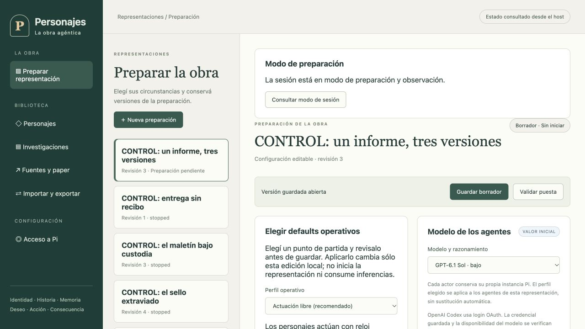

# Defaults elegibles

Pedido del usuario: todas las decisiones deben ofrecer buenos puntos de partida para elegir. Implementado el 16 de octubre de 2026.

- Operación: Actuación libre (recomendada), Dirección manual o narrador textual. Propuestas locales editables, con explicación previa; no guardan ni llaman al modelo. Sin topes acumulados de llamadas o tiempo; concurrencia 1 y timeout individual de 300 segundos.
- Modelo: se conserva la elección entre Sol 6.1 bajo y Claude Opus 5.5 medio, mediante login del proveedor, sin sustitución automática.
- Personajes: preparación recomendada del siguiente pendiente o de todo el reparto. Usa fuentes exactas disponibles, biografía, historia, deseos, Goals y voz; no escribe diálogos ni desenlaces. Registrar, iniciar y aplicar son operaciones separadas.
- ICM: selección recomendada por audiencia con fuentes existentes, conservando la separación de los actores. Previsualizar y admitir siguen siendo explícitos.
- Interlocutor: Visitante de CONTROL o Cronista visitante, editables. Son identidades ficticias, sin secretos ni autoridad automática.
- Audio: español, subtítulos y síntesis manual por publicación. Los modelos se consultan explícitamente al proveedor y se filtran por capacidad e idioma; no se inventan IDs ni voces.

Verificación: `npm run verify` con TMPDIR=/private/tmp e ICM real: 1513 pruebas, 1512 aprobadas, 0 fallidas, 1 omitida. Build aprobado. Host 4182 actualizado y opciones verificadas en la interfaz; el borrador de tres actores conserva revisión 3, sin iniciar.

Esto no acredita una representación completa. El borrador aún tiene cero actores preparados y un error estructural del Escenario (array requerido ausente), que debe corregirse antes de Ready. La preparación automática anterior terminó por timeout sin propuesta aceptada; no se reutiliza como resultado válido.
