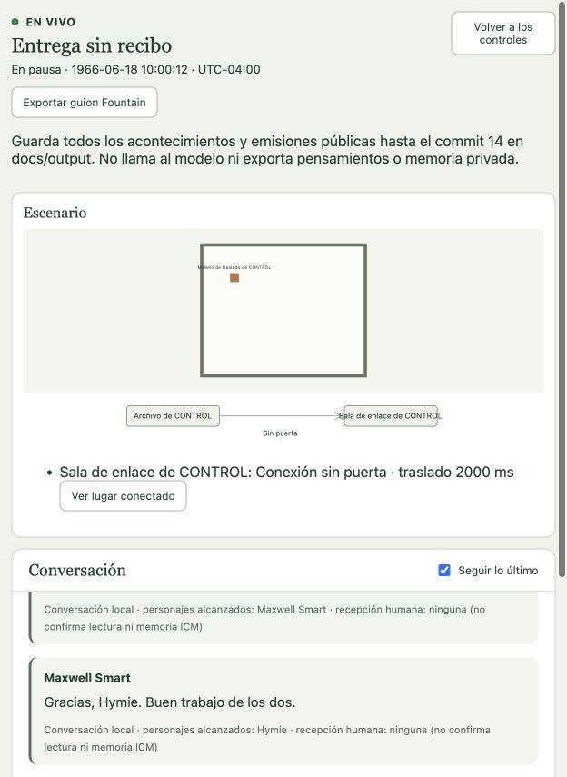

# Dejar objetos y conservar lo que ocurrió

El ensayo [El maletín bajo custodia](../representaciones/el-maletin-bajo-custodia.md) alcanzó el Archivo, pero Max no tenía cómo dejar el maletín allí y regresar sin él. La acción `putDown` completa esa posibilidad física; no cambia la historia del ensayo anterior ni convierte su final abierto en un desenlace resuelto.

## Contrato

El personaje necesita la capacidad explícita de dejar objetos y debe llevar un objeto portátil. Lo sitúa en su lugar y posición actuales: el modelo no aporta coordenadas ni elige una sala remota. La operación actualiza la ubicación y revisión del inventario atómicamente, invalida ofertas abiertas sobre ese objeto y registra `objectPlaced`. Usa el tiempo configurado para manipular objetos (`takeMs`), mostrado como «Tomar o dejar» en preparación. No equivale a entregarlo a otro personaje ni a abrirlo, consumirlo o certificar su contenido.

La percepción propia está respaldada por el evento y permite continuar. Los demás sólo lo perciben desde una situación visual accesible. El depósito puede generar una Experience del evento en la memoria de quien lo percibe; no se añade conocimiento automático a personajes en otra sala. El objeto queda físicamente allí cuando el personaje se marcha, y otro puede intentar tomarlo según sus capacidades y alcance. Un objeto que bloquea movimiento sigue sujeto a las colisiones de los destinos posteriores.

La nueva capacidad se prepara de forma expresa. Las configuraciones históricas conservan su ausencia; no reciben una concesión ni una migración silenciosa. Se mantienen las fronteras de herramientas: dejar un objeto de ficción no habilita escrituras arbitrarias en el filesystem.

## Observación y guion

Los acontecimientos públicos y el guion distinguen «ofreció», «aceptó la entrega», «dejó» y «venció la oferta». Se usan etiquetas públicas y el estado del corte de cada evento; no identidad privada ni el presente para completar el pasado. Los guiones ya exportados permanecen intactos. Las nuevas exportaciones conservan corte y hash propios.

## Verificación

Núcleo: 101 pruebas aprobadas. Incluye rechazo sin custodia o capacidad, ubicación propia, invalidación, nueva toma, movimiento posterior conservando el objeto en su lugar, testigos situados y continuidad con reapertura/replay, Experience e intención durable. La integración adicional usa journal SQLite real, oferta, aceptación, entrega de percepción, depósito, proyección histórica y Fountain sin inferencia. También verifica vencimiento y ausencia de entrega inventada.

Verificación global antes de los últimos ajustes de etiquetas y límite del formulario: **1483 pruebas, 1482 aprobadas, cero fallidas y una omitida**, typecheck y build correctos. Log local `/private/tmp/personajes-putdown-verify.log`. Después, typecheck, build y 26 pruebas focales de preparación/proyección/interfaz también pasaron. El formulario admite las seis acciones explícitas actuales; no aumenta permisos por omisión.

La prueba controlada no acredita por sí sola una actuación completa con el proveedor ni calidad dramática. La siguiente puesta se registra por separado.

## Hallazgos durante la aceptación real

[Entrega sin recibo](../representaciones/entrega-sin-recibo.md) ejecutó depósito, regreso y aviso con el proveedor real. El Director registró desenlace operativo suficiente; el asentimiento de Hymie utilizó el canal gestual correcto. La consulta SQLite de sólo lectura confirmó el evento de depósito, percepción propia entregada, Experience con recibo ICM `projected` e input consumido por un turno aceptado de Max. No había testigos en la otra sala; Hymie se enteró por el aviso posterior.

En ventana de 624 px, las conexiones consumían toda la altura del área de escenografía y el plano se contraía a cero. Se amplió la fila y se aseguró un mínimo de 180 px para el plano. El navegador verificó 180 px de altura y 573 px de ancho, con el maletín en Archivo después de que Max regresó. La comprobación se hizo con la función en pausa, sin otra inferencia.

La pausa produjo un turno bloqueado `job-inactive` de una época anterior y una solicitud de transporte `ambiguous`. El guard estructural confundía ese registro con autoridad actoral vigente e impedía cerrar después de reiniciar. Ahora sólo ignora épocas demostrablemente anteriores; las épocas actuales, futuras o desconocidas siguen bloqueando. No cambia generaciones, percepciones, respuestas ni reservas inciertas. Los guards de reanudación e inferencia conservan esa incertidumbre. Regresión con pausa, reapertura y reserva ambigua intacta, más bloqueo de jobs vigentes: journal 48/48, typecheck correcto.

El HTTP distingue `ACTOR_JOBS_ACTIVE` con un mensaje público accionable. La GUI muestra una operación en curso mientras espera la respuesta; sólo ofrece reintento cuando sigue sin confirmación después del envío. Focales de superficies: 15/15. Las negativas idempotentes anteriores permanecen negativas; un nuevo cierre requiere una operación nueva.

La aceptación real del cierre quedó completada: escena en commit 15 y episodio en commit 16, desde la GUI y conservando el turno cancelado y la reserva ambigua. Verificación global final tras todas las correcciones: **1487 pruebas, 1486 aprobadas, cero fallidas y una omitida**, además de typecheck, build y formato correctos. Log local `/private/tmp/personajes-putdown-closure-final-verify.log`.
