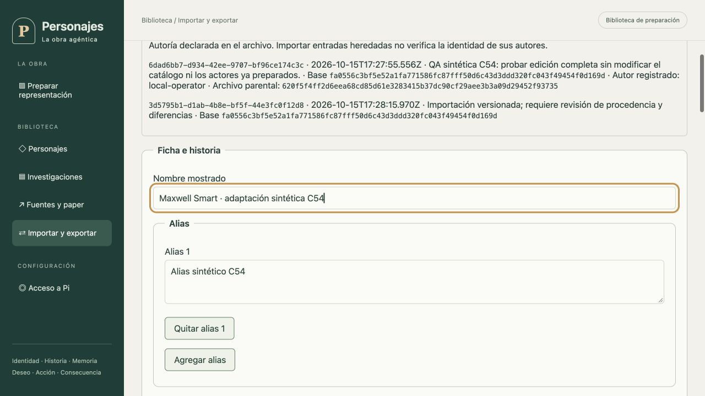

# Edición integral de expedientes — corte 54

La biblioteca incorpora un editor gráfico de adaptaciones. El original investigado, las adaptaciones anteriores y las preparaciones ya guardadas permanecen intactos. La elección de una adaptación para un actor sigue siendo explícita mediante el [selector C53](seleccion-de-fuentes.md).

## Campos y autoridad

Se editan nombre mostrado, alias, intérpretes, manuscrito Markdown, fuentes con ID/tipo/referencia/alcance/incertidumbre, vacíos, contradicciones, referencia visual y receta de voz con sus referencias. La identidad operativa del personaje, hashes, revisión y ascendencia no se reciben como campos editables. El servidor deriva secciones y secciones desconocidas del manuscrito y calcula hashes; no hay un segundo editor de secciones incompatible con el texto.

El contrato estricto rechaza campos administrativos o procedencia propuesta por el cliente. Se comprueban IDs de fuente duplicados, referencias de voz inexistentes y avatar de otra identidad. Las filas vacías se mantienen mientras se redacta y la vista previa valida su contenido. El contenido documental no se ejecuta como instrucciones ni HTML.

Cada edición local añade una entrada de adaptación editorial con ID, motivo, fecha, autor del principal autenticado, hash completo parental, revisión y hash Markdown parentales. El archivo editado recibido mantiene la revisión parental; el envoltorio normal de importación incrementa una sola revisión al guardar. Por tanto, el archivo recibido y la adaptación materializada tienen hashes completos distintos. Los registros antiguos sin metadata editorial conservan su representación.

La autoría de entradas heredadas es una declaración del archivo: importar una entrada que diga “local-operator” no autentica esa identidad. La interfaz lo explica en el historial; la confirmación muestra específicamente la entrada nueva estampada por este host. El hash parental documenta el parentesco comprobado durante la creación local, no una firma verificable entre hosts ni una certificación de canon.

## Revisión, confirmación y reintentos

POST `/dossier-edits/preview` recibe referencia exacta de fuente, campos editables y motivo. Resuelve catálogo o adaptación del operador y conserva antes/después completos, hashes, token y caducidad. La interfaz enumera campos cambiados y permite consultar ambos expedientes y metadatos.

POST `/dossier-edits/apply` exige importId, previewToken, confirmDiffHash y If-Match del import. Los controles HTTP existentes aplican sesión, origen, CSRF e idempotencia. La confirmación explícita guarda una adaptación independiente. Los intentos inciertos conservan la solicitud y clave originales; reintentar no cambia su contenido. Cambiar el formulario invalida la revisión anterior. No se selecciona una fuente para actores ni se inicia una representación al guardar.

Se reutilizan tablas selladas de exchange, sin DDL nuevo. Una preview persistida puede recuperarse después de reinicio sin rebasarla sobre el catálogo actual. La aplicación aún pendiente verifica fuente parental exacta y caducidad; un cambio parental exige revisar de nuevo. Un efecto ya guardado se recupera antes de comprobar caducidad o catálogo, pero verifica ambos registros sellados y su linaje. La revisión independiente reprodujo un fallo en ese retorno anticipado: un import corrupto podía coexistir con un replay exitoso. La corrección y una prueba de corrupción comprueban rechazo sin reparación ni efectos adicionales.

## Evidencia ejecutada

Las pruebas usan SQLite real y rutas HTTP reales: todos los campos, normalización de secciones y fences, metadata distinta con igual Markdown, autor y fecha del host, fuente equivocada/privada, confirmación incorrecta, expiración, padre cambiado, edición sobre adaptación guardada, reinicio/replay y recibo HTTP incompleto después del efecto. La fuente resultante valida su snapshot autocontenido con ambos hashes. El formulario tiene pruebas de preservación de campos/blancos, render seguro y captura inmutable del intento.

En un host sintético se editó el nombre mostrado y un alias de Maxwell Smart, se escribió motivo, se revisó y confirmó la adaptación. Tras reiniciar se reabrió la nueva revisión con valores y linaje conservados. El original siguió mostrando “Maxwell Smart”; la preparación anterior conservó su hash y adaptación previos. Se verificó que el avatar ofrecido pertenece al personaje y que la página no desborda horizontalmente a 1280 píxeles.

Verificación global: **1.160 pruebas aprobadas, cero fallos y una omitida exclusiva de Linux** (1.161 totales), con ICM real; TypeScript y build correctos. La revisión independiente ejecutó 18 pruebas focales sin bloqueantes después de la corrección. Los ajustes finales de presentación también pasaron TypeScript, build y cuatro pruebas de formulario.

## Alcance restante

Esto acredita el editor y sus fronteras, no la aceptación visual de todos los expedientes/avatares ni la calibración audiovisual del ritmo, puesta real, inferencia y audio integrales u otros puntos de [PENDIENTES](../PENDIENTES.md). Los datos del navegador son sintéticos, no una nueva definición canónica del personaje. Los 77 requisitos siguen pendientes de aceptación integral y el objetivo completo continúa activo.
