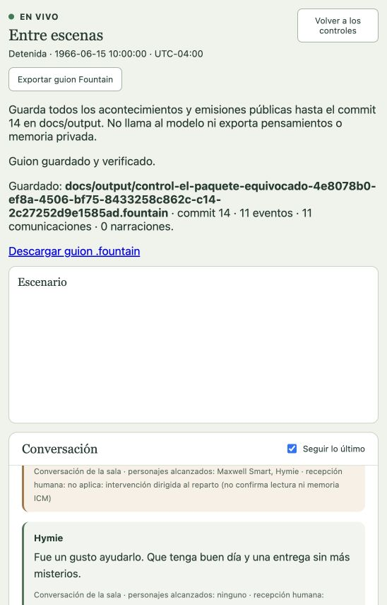

# Exportación de una ejecución a guion

16 de octubre de 2026 UTC. Implementación posterior al pedido de guardar el resultado de una ejecución con formato de script en `docs/output`. Cambios locales en `main`, base `3892c0b`, sin commit ni push nuevos.

## Entrega

La vista en vivo y Escenario ofrecen **Exportar guion Fountain**. El clic fija el commit confirmado y guarda un `.fountain` legible en `docs/output`, con portada, encabezados de escena/lugar, personajes en mayúsculas, diálogos, acciones y voces en off públicas si existen. Incluye trazabilidad al principio, sin UUIDs entre réplicas. No infiere diálogos, pensamientos, acciones a partir de declaraciones ni desenlaces faltantes.

La colección recorre todas las páginas de eventos/comunicaciones y usa sus cortes históricos, no sólo los mensajes visibles de la pantalla. Los lugares del encabezado pertenecen a la escena. Las publicaciones narrativas se distinguen de su corte fuente y no se atribuyen como percepciones del reparto. Caracteres que parecen sintaxis Fountain se escapan para conservar el habla como texto.

`POST /api/v1/runs/{runId}/script-exports` exige sesión, Origin, CSRF y una clave idempotente; el único dato de cuerpo es el commit. Es una acción administrativa de la persona, no una herramienta ficticia del actor, y no requiere cambiar su modo de interlocución. El resultado ofrece un GET autenticado de descarga, sin caché. Nunca recibe rutas del cliente. El servicio comprueba archivos/directorios, rechaza enlaces y contenido modificado, escribe de manera exclusiva y no sobrescribe resultados diferentes. Los recibos privados conservan petición y corte de publicación para reintentar sin inferir ni cambiar el guion.

La GUI conserva clave y corte ante respuesta perdida, incluso tras remontar y avanzar el presente; no reenvía automáticamente ni descarga por sí sola. Cambio de corrida/cliente o sesión invalida respuestas tardías y retira el recibo; una operación incierta puede recuperarse explícitamente. El enlace y la ruta distinguen el corte exportado del presente actual.

Los guiones son archivos del repositorio; los recibos de operación están bajo `privateDataRoot/script-exports` y no forman parte del backup portable vigente. Un guion no restaura memorias, sesiones ni journal. La inspección ICM y el Configurador previo a Ready son capacidades separadas; ver [estado](inspector-icm-y-base-configurador.md).

## Evidencia real y pruebas

[El paquete equivocado](../representaciones/el-paquete-equivocado.md) terminó sin Fibonacci y fue exportado desde la GUI del host habitual 4182 en commit 14. Once emisiones y once eventos; el archivo de 2943 bytes coincide con las réplicas de la interfaz. La descarga productiva dio HTTP 200, `private, no-store`, attachment y exactamente los mismos bytes/hash. No hubo actuación adicional al exportar.

Trece pruebas focales aprobadas: journal real con 106 emisiones y dos escenas/cierres, narración pública aceptada, sintaxis Fountain, filesystem/reapertura/replay, HTTP auth/CSRF/descarga, React+cliente, incertidumbre, cambios de sesión y retiro de respuestas tardías. Typecheck y build aprobados. Suite global final con ICM 0.11.4 real y `TMPDIR=/private/tmp`: **1396 tests, 1395 aprobados, cero fallos y una omisión exclusiva de Linux**. `git diff --check` limpio. Logs locales `/private/tmp/personajes-script-export-combined-final.log` y `/private/tmp/personajes-script-export-global-final.log`. La aceptación global del producto sigue abierta.
