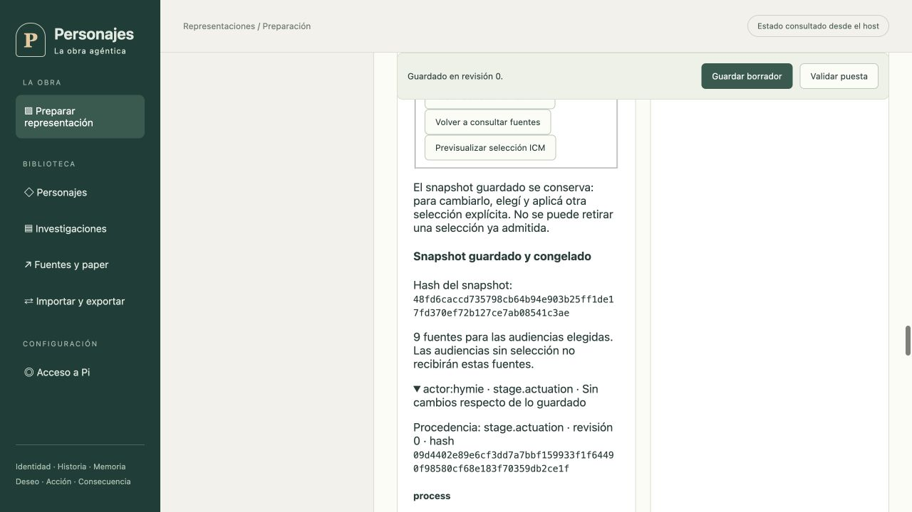

# ICM Markdown · integración al runtime v43

Corte local del 15 de octubre de 2026. Rama `main`, base `3892c0b`; cambios todavía sin publicar. Continúa la [fundación](icm-markdown-fundacion.md) y el [plan](../diseno/plan-icm-markdown-runtime.md). No cierra MEM-07 ni la aceptación completa del producto.

## Implementado y comprobado

- El journal v43 guarda `icm_context_packets`, con scope, paquete y receipt canónicos, checksums completos y guards de inmutabilidad. El sello semántico `packetHash` es distinto del checksum del JSON completo y de `preparedContextHash`.
- El host deriva audiencia, job, generación, configuración y corte desde el trabajo reclamado. Un paquete debe existir antes de reservar/despachar; si desaparece después de evidencia durable de inicio, no se regenera. Reinicio y repetición reutilizan el paquete guardado.
- Actor, Continuista, Director, Narrador, Revisor de narración y Configurador de evolución usan `icm-session-context.ts` antes de crear sesión Pi. Conservan sesiones independientes y `noContextFiles`; los registros históricos sin ICM mantienen su camino anterior. El Markdown no concede filesystem ni tools adicionales.
- Las rutas autenticadas de fuentes y preview aceptan IDs/secciones del manifiesto, sin rutas del cliente. Guardar verifica hashes y fuentes actuales; una selección ya admitida no puede retirarse silenciosamente. El preflight comprueba la disponibilidad del runtime de paquetes cuando hay selección.
- La GUI selecciona fuentes por audiencia, muestra diferencias, bytes Markdown, procedencia y hashes y aplica localmente antes de guardar con revisión. Las respuestas tardías no pisan cambios de reparto o sesión. La ausencia de snapshot ya no se etiqueta automáticamente como preparación histórica.
- Backup/restauración reconocen v43 y conservan compatibilidad de esquema con versiones anteriores. El worker externo valida todas las filas de paquetes, incluso fuera de los fences exportados: JSON canónico, checksums, scope/receipt, fuentes, preparación actoral y contrato compilado contra el snapshot histórico. Lo hace sobre copia privada creada con DDL del host; no lee el árbol Markdown actual. Una corrupción provoca `EXTERNAL_BACKUP_ICM_CONTEXT_INVALID`.

## Verificación

`npm run verify` con `TMPDIR=/private/tmp` y el binario local ICM 0.11.4 real: **1335 tests, 1334 aprobados, cero fallos y una omisión exclusiva de Linux**. Incluye typecheck. `npm run build` también pasó. Logs locales: `/private/tmp/personajes-icm-v43-global-final.log` y `/private/tmp/personajes-icm-v43-build-final.log`; no son artefactos transferidos por Git.

Las pruebas nuevas cubren Actor/Continuista con journal real, los roles administrativos con SDK controlado, separación de audiencia, persistencia/reapertura, paquetes ausentes tras reserva y corrupción. La auditoría histórica valida un paquete poblado y rechaza un contrato adulterado aun con sellos/checksums recalculados. La prueba del worker aislado rechaza filas inválidas aun cuando el manifest tenga el nuevo hash del archivo y no haya fences. Esto no acredita por sí solo un round-trip entre dos hosts con paquetes poblados.

La primera pasada global detectó un test de presets que contaba las consultas GET del selector como guardados. Se actualizó su servidor de prueba y la aserción permite únicamente esas lecturas adicionales; sigue prohibiendo escrituras e inferencias antes del guardado explícito. La segunda pasada global pasó.

Recorrido gráfico en instancia aislada `127.0.0.1:4183`, raíz temporal de QA distinta del host habitual: elegir ensayo Max/Hymie, marcar secciones de cinco audiencias, previsualizar nueve fuentes, aplicar y guardar. La interfaz confirmó revisión 0 y snapshot `48fd6caccd735798cb64b94e903b25ff1de17fd370ef72b127ce7ab08541c3ae`; se abrió una fuente y se verificó Markdown, revisión y hashes. El borrador se llama «QA ICM · Max y Hymie (sin ejecutar)». No se validó como Ready ni inició representación. No se usó login ni inferencia de proveedor en este recorrido.

## Pendientes que impiden cerrar el alcance

1. Corte posterior: altas nuevas por API y presets registran `icmWorkspace` pendiente. El host lo agrega aun si un cliente antiguo omite el campo; reemplazar omitiéndolo conserva la selección pendiente. Ready exige selección configurada. Registros históricos y constructor estructural conservan ausencia, sin backfill. Verificación posterior registrada al final.
2. Job de Configurador anterior a Ready. El worker conectado actualmente es el de evolución; el tipo de corte de preparación no acredita un flujo ejecutable.
3. Inspección gráfica por rol/job implementada y verificada en un corte posterior; ver [Inspector y límites](inspector-icm-y-base-configurador.md). Queda aceptación integral de conflictos/recuperación y vínculos completos entre jobs/sesiones/terminales.
4. Transferencia real entre dos hosts con paquetes poblados. La auditoría nueva comprueba integridad interna y configuración/corte; falta acreditar exhaustivamente las relaciones históricas con cada job, checkpoints y sesiones. No prueba autenticidad del emisor de un backup.
5. Resuelto en el corte posterior: [representación nueva con proveedor real](../representaciones/pregunta-a-tiempo-icm.md), nueve fuentes explícitas y 29 paquetes de actores, Continuista y Director hasta cierre de episodio. Narración, audio y Configurador con proveedor real no se acreditan por ese recorrido.

El servidor habitual en 4182 no fue reiniciado ni se migraron sus datos en este corte. Consultar [PENDIENTES](../PENDIENTES.md) para los demás requisitos y [handoff](../../handoff/README.md) para continuar desde otra máquina.

## Prioridad y obligatoriedad de nuevas preparaciones

Por indicación posterior del usuario, la importación deja de ser el camino crítico: priorizar preparación, representación visible e interacción humana. Su aceptación exhaustiva permanece en V2. La prueba HTTP productiva demuestra que un borrador antes válido sin ICM nace ahora pendiente y no promueve a Ready; omitir el campo en un PUT tampoco elimina ese requisito. Los presets en blanco, de ensayo y documentales lo muestran desde la edición local. El journal admite campos pendientes sin exigir lectura de fuentes hasta configurar una selección; los snapshots configurados conservan la verificación de procedencia.

Verificación del corte posterior de obligatoriedad: `npm run verify` con ICM CLI real volvió a pasar con 1335 tests, 1334 aprobados, cero fallos y una omisión exclusiva de Linux; build aprobado. Log local `/private/tmp/personajes-icm-new-preparations-global-final.log`. La prueba de promoción HTTP ahora aporta una selección ICM explícita con autoridad de fuentes controlada; la prueba de guardado usa la composición productiva y fuentes del filesystem real.

## Preparación nueva y actuación real · 16 de octubre

[Auditoría posterior](preparacion-nueva-y-contexto-icm.md): preparación manual nueva y Ready con nueve fuentes, preflight durable de dieciséis gates, actuación real y cierre gráfico completo. El host habitual 4182 sí se reinició en este corte posterior. La función conserva 29 paquetes verificados readonly y memorias SQLite independientes; no hereda ausencia de ICM de las funciones previas. Configurador anterior a Ready e inspección gráfica de paquetes siguen pendientes.
