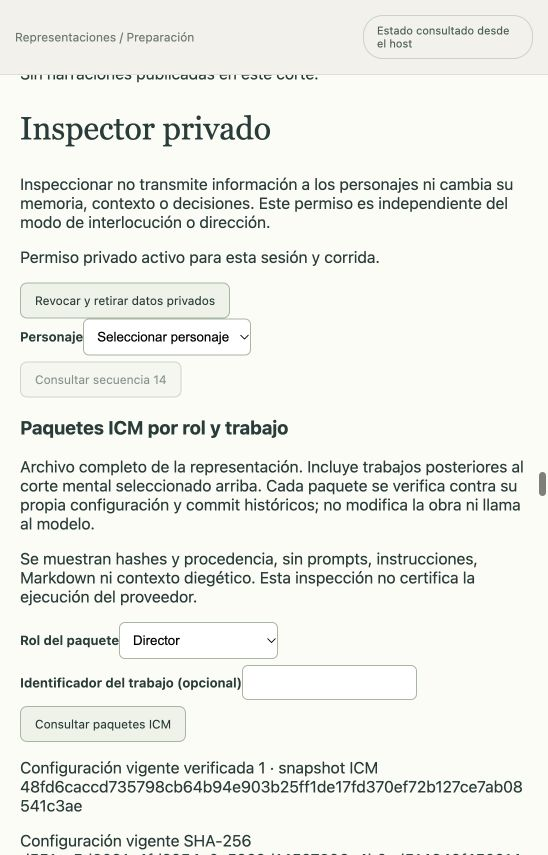

# Inspector ICM y base del Configurador de preparación

Corte: 16 de octubre de 2026 UTC, `main` base `3892c0b`, cambios locales sin publicar.

## Inspector implementado y verificado

El Inspector privado incluye una consulta paginada de paquetes ICM por rol, actor y trabajo. La API exige el opt-in privado de la sesión para esa representación antes de leer el journal. La proyección muestra audiencia, job/generación, configuración/corte históricos, compilador, sellos y procedencia de fuentes/secciones; no devuelve Markdown, políticas, contexto diegético, prompts, memorias, rutas de sesiones ni credenciales. No invoca proveedores.

Cada fila se verifica mediante el auditor compartido contra su configuración histórica congelada y checkpoint del corte. Un paquete corrupto queda señalado sin ocultar los válidos ni reconstruirse desde el árbol actual. La ausencia de filas no se interpreta como ausencia histórica de ICM. El alcance es el archivo completo de la representación, explícitamente separado del corte mental seleccionado en el Inspector. La verificación del paquete y su corte no certifica toda la ejecución del proveedor ni todas las relaciones entre sesiones, jobs y terminales.

Los datos se retiran al revocar, perder permiso, cambiar sesión/representación o desmontar. Una revisión independiente detectó que un rechazo 401/403 sin JSON no retiraba el badge del padre; se corrigió clasificando el status antes del body y se probó con cliente real y React montado.

Pruebas: 34 focales del responsable, incluidos SQLite/journal reales, HTTP autenticado, CSRF del opt-in, paginación/filtros, corrupción aislada, reapertura y promoción real con ICM. Tras promover una identidad, el paquete sigue validándose contra su revisión original; corromper esa fuente histórica vuelve corrupta la fila. Revisión independiente: 11 focales aprobados. No se usaron proveedores.

GUI habitual 4182: en [Una pregunta a tiempo](../representaciones/pregunta-a-tiempo-icm.md), activar Inspector, consultar 25+4 paquetes (29 verificados, ninguno corrupto), filtrar Director (7), Max (6), un job final de Max (1), abrir sus dos fuentes y revocar. La interfaz retiró el panel. La función permaneció detenida, sin nueva inferencia. La selección exacta por etiqueta del combo requiere su región/rol en la automatización; la asociación HTML del control se conserva.

## Base pura del Configurador, todavía sin ejecución

`preparation-configurator.ts` y su compilador definen entrada sellada de borrador incompleto, perfil/presupuesto configurados, fuentes concretas y snapshot ICM admitidos, y propuestas tipadas por puesta, nueve secciones actorales y colocaciones. El overlay es `proposed-only`: no modifica el borrador, no confirma datos y no ejecuta Pi. La compilación comprueba integridad de snapshots que el host ya debió admitir; no demuestra ownership ni procedencia por sí sola.

Se conservan vacíos y contradicciones. Una adaptación de conocimiento requiere motivo y antecedentes propios, sin fabricar adaptationId administrativo; retirar una contradicción de una identidad previa exige tratamiento explícito y conserva el registro documental. El modelo no propone perfil, presupuesto, ICM ni identidad humana; tampoco sella revisiones/confirmaciones. La proyección al modelo conserva la preparación necesaria, pero retira bytes de contratos ICM ajenos: éstos quedan sólo como hashes/metadatos, mientras el contrato procedural del Configurador sí entra en su paquete.

Dieciséis focales aprobados, incluidos ocho nuevos del contrato. No hay tool, job, worker, ledger, API ni GUI de Configurador previo a Ready. El [diseño completo](../diseno/configurador-preparacion.md) conserva el trabajo restante, especialmente autoridad durable de presupuesto y paquetes anterior a world_runs. No se crean representaciones ficticias para eludir esa dependencia.

## Verificación global de este corte

`npm run verify` con ICM CLI 0.11.4 real y `TMPDIR=/private/tmp`: **1383 tests, 1382 aprobados, cero fallos y una omisión exclusiva de Linux**; typecheck aprobado. Build del inspector aprobado, con aviso conocido de tamaño de chunk. Log local `/private/tmp/personajes-inspector-and-preparation-global-final.log`. Este resultado es anterior a la implementación posterior de exportación Fountain y no la acredita.
