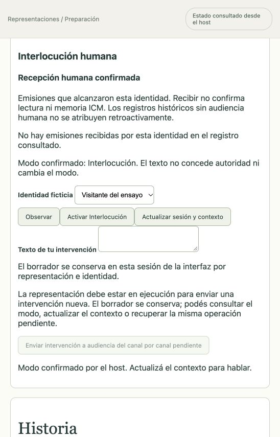

# Recepción humana situada · 15 de octubre de 2026

Este corte implementa destinatarios humanos en las comunicaciones actorales. La decisión y sus alternativas están en [ADR 0017](../adr/0017-recepcion-humana-situada.md). Amplía el contrato de conversación; no acredita por sí solo una obra completa ni la aceptación integral de UI-04.

## Comportamiento implementado

- El inicio registra presencia pública mínima en un corte nuevo. Una intervención futura puede admitir a su emisor. El snapshot inicial, los cortes anteriores y sus hashes conservan sus datos.
- El actor adquiere handles humanos por percepción situada o testimonio recibido. No recibe el perfil privado ni el identificador administrativo; un alias declarado no certifica identidad.
- Comunicación dirigida y broadcast registran por separado audiencia humana solicitada y efectiva. Presencia, escena, modalidad, alcance y canal gobiernan recepción. Una presencia en escena puede ver gestos por canal visual compatible distinto de su habla; una presencia remota conserva su enlace.
- La recepción humana no crea una instancia Pi, una percepción para ICM ni un acuse de lectura. La comunicación pública conserva sus permisos actuales; dirigir no equivale a secreto.
- La bandeja HTTP deriva la identidad de la sesión interlocutora, separa identidades del mismo operador y valida cada elemento. Consultarla no escribe ni llama al modelo.
- La GUI consulta incrementos por secuencia y deduplica por evento. Al cambiar identidad descarta respuestas tardías; un delta vacío conserva recibos anteriores. Las identidades configuradas siguen seleccionables tras cerrar escena, sin colocarlas nuevamente en el mapa ni habilitar envío.

## Evidencia y límites

`tests/human-reception-journal.test.ts` ejecuta el journal SQLite y el worker con transporte controlado: recibe testimonio, adquiere el handle, emite una respuesta dirigida sólo al humano, conserva audiencias vacías de personajes y no crea entregas ICM humanas. El replay no duplica el evento. Otra prueba conserva el snapshot inicial al registrar el roster en start.

Las pruebas de dominio cubren modalidad, oscuridad, rango, canal deshabilitado, escena, remoto, audiencias mixtas, corte obsoleto, privacidad y ausencia de defaults históricos. Las pruebas HTTP/cliente/React cubren sesión, identidad, paginación incremental, respuestas tardías y consulta después del cierre.

El navegador del host real se reinició con este build. En la representación detenida «La alarma de los números», con escena y episodio cerrados, se seleccionó «Visitante del ensayo» y se activó Interlocución. La bandeja se mostró sin recepciones registradas, con explicación de ausencia histórica y envío bloqueado. Los eventos antiguos permanecen sin audiencia humana; no se los atribuye retroactivamente.

La consulta histórica no consumió inferencia. Posteriormente se ejecutó [El visitante y el aviso](../representaciones/el-visitante-y-el-aviso.md), una puesta nueva con OAuth OpenAI real: Hymie emitió dos mensajes dirigidos sólo al visitante, incluido el análisis solicitado, y ambos aparecieron en su bandeja. Se cotejaron eventos/audiencias y ausencia de percepciones ICM humanas. El primer bloqueo de Max reveló una brecha de recuperación sin inbox, resuelta después con [journal v42](recuperacion-activaciones-y-diagnosticos.md). El mismo ensayo terminó con 11 intervenciones y cierres estructurales de escena/episodio en commits 15/16; esto no acredita aceptación dramática integral. Fidelidad actoral integral, ritmo audiovisual y recuperación de turnos durante trabajo activo siguen pendientes.

## Verificación del corte

`npm run verify` con ICM real terminó con 1265 tests: 1264 aprobados, cero fallos y una omisión por plataforma. `npm run build` y `git diff --check` pasaron. Este conteo pertenece al corte de recepción humana y no reemplaza la aceptación por requisito. Revisión independiente de autoridad/historia y de consulta incremental sin hallazgos bloqueantes.

Después se agregaron dos regresiones sin modificar producción: recepciones repartidas entre páginas y delta inclusivo sin duplicar la frontera; respuesta pendiente de A resuelta después de activar B sin filtrarse a su bandeja. La ejecución focal posterior de cliente y React pasó 13/13, sin omisiones. Ese resultado complementa la suite global anterior; no es otro conteo global.
