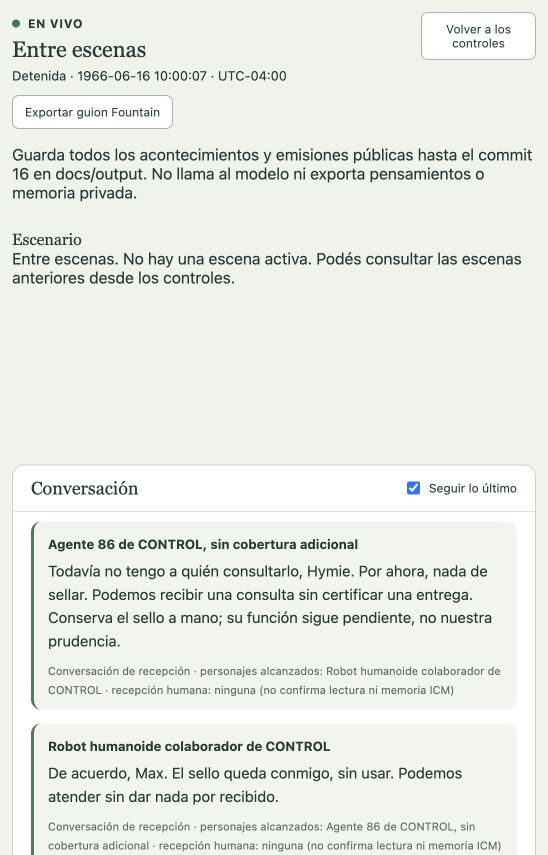

# Continuar después de un intento no realizado

El ensayo [El sello extraviado](../representaciones/el-sello-extraviado.md) dejó un fallo concreto: Max propuso asentir por un canal de habla. El Escenario lo rechazó con `channel-kind-mismatch`; no hubo gesto público. Ese resultado no generaba una nueva causa actoral, de modo que el personaje no podía reconsiderar su acción.

## Comportamiento incorporado

La herramienta actoral comprueba los canales que el host le entregó antes de registrar una propuesta. Hablar requiere canal de habla; un gesto requiere canal gestual y, cuando está informada, modalidad compatible. Asentir/señalar son visuales; ladridos/gemidos son auditivos. Un canal inventado o incompatible devuelve una indicación privada de corrección, sin registrar ni ejecutar la acción. El modelo puede elegir otro canal o una acción distinta. La resolución autoritativa del Escenario sigue siendo necesaria después de la propuesta.

La proyección de canales gestuales incluye su modalidad. El campo es opcional para leer contextos históricos sin rellenarlos ni cambiar sus bytes; los canales de habla mantienen su forma anterior.

Si una propuesta admitida de un job actoral termina `notApplied`, el journal genera un `actionFeedback` privado para su actor en la misma transacción que el commit. No modifica la resolución original ni el snapshot, no agrega un evento público, no avanza la secuencia y no fabrica una Experience ni memoria ICM. El resultado llega al inbox como una acción que no ocurrió: permite reconsiderar sin inferir un obstáculo físico secreto ni convertirlo en diálogo o testimonio ajeno. No se atribuye este recorrido a intentos administrativos sin un job actoral.

La cadena y firma internas no llegan al contexto del modelo. El feedback y su entrega quedan conservados; el replay de la operación original no los duplica. No se rellenan causas de intentos históricos.

## Repetición y agencia

La continuación no se limita a un número fijo de llamadas. Cambiar de acción, razón de rechazo o estado permite reconsiderar. Repetir en la misma cadena una acción idéntica con la misma razón y revisión conserva el feedback, pero no crea otra convocatoria automática: no apareció información nueva que sostenga un ciclo infinito. Los controles de presupuesto seleccionados para la representación siguen siendo independientes.

## Verificación

La regresión reproduce un gesto rechazado, persistencia privada sin evento/Experience, reapertura y replay sin duplicación, entrega al actor y nuevo pulso. Después prueba una acción distinta que abre otra reconsideración y una repetición idéntica que no vuelve a convocar. También comprueba que el actor no recibe feedback ajeno, firmas ni IDs internos. Focales del núcleo: 71 pruebas aprobadas y typecheck limpio. Las pruebas de canales, proyección y vista en vivo también pasaron.

La interfaz al finalizar una escena muestra «Entre escenas» en lugar de un plano vacío, manteniendo la conversación y el acceso al guion. Este cambio no altera el guion ni reinterpreta la actuación histórica. La aceptación con proveedor real de un episodio completo y la evaluación artística siguen pendientes; una regresión controlada no las sustituye.

Verificación global final: `TMPDIR=/private/tmp PERSONAJES_ICM_TEST_BINARY=/Users/andrestobelem/.local/bin/personajes-icm-0.11.4 npm run verify`: **1476 pruebas, 1475 aprobadas, 0 fallidas y 1 omitida**. Typecheck, build y control de formato aprobados. Log local `/private/tmp/personajes-action-feedback-final-verify.log`. No hubo llamadas al proveedor para esta regresión.

El host de 4182 se reinició sólo después de confirmar que el ensayo estaba detenido y no había actores ni preparaciones en curso. La GUI mostró el nuevo mensaje de estado con los seis parlamentos históricos conservados:

## Continuación tras acciones físicas aplicadas

El siguiente corte incorpora percepción propia de `move`, `take`, `acceptOffer` y `useDevice`. Está respaldada por el evento real: el journal comprueba actor, intento y tipo antes de convocar la continuación. Puede producir una Experience propia del acontecimiento; se distingue del feedback de una acción que no ocurrió. Hablar, ofrecer, esperar y descansar no generan autoeco. No se rellenan percepciones históricas.

La regresión de movimiento solitario verifica reapertura y replay sin duplicados, memoria respaldada por el evento y nuevo trabajo en el destino. Núcleo: **74/74 pruebas**. Verificación global posterior: **1479 pruebas, 1478 aprobadas, 0 fallidas y 1 omitida**, con typecheck, build y `git diff --check` correctos. Log local: `/private/tmp/personajes-maletin-verify.log`. Esto acredita la corrección controlada; la representación real se registra por separado.
