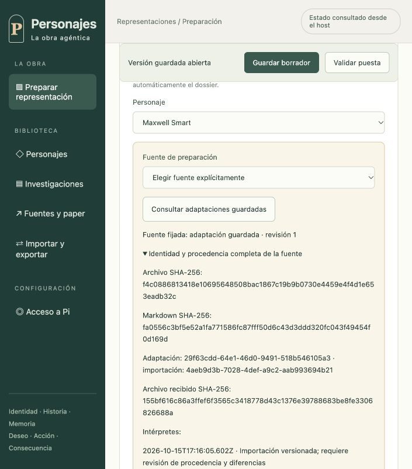

# Selección de fuentes de preparación — corte 53

El selector gráfico conecta los fundamentos del [corte 52](fuentes-de-preparacion.md) con la curación y el guardado autenticado. No acredita edición integral del expediente ni aceptación de todos los requisitos del producto.

## Comportamiento construido

Cada personaje puede usar explícitamente el original del catálogo o una adaptación guardada del operador. La biblioteca se consulta a pedido, tiene paginación y no elige automáticamente la versión más reciente. Se muestran revisión, hashes completos, identificadores y procedencia disponible. Una preparación ya guardada abre su snapshot congelado sin consultar catálogo o biblioteca; la ausencia legacy se informa y requiere selección explícita antes de volver a curar desde la interfaz.

GET `/preparation-sources/catalog/{characterId}` congela el catálogo del host; GET `/preparation-sources/adaptations/{adaptationId}` resuelve la adaptación del operador. Ambos devuelven una fuente completa verificada y ETag `"preparation-source:<fullArchiveHash>"`. Rechazan queries y rutas inválidas; no modifican preparaciones, generan recibos ni llaman modelos. El cliente contrasta la identidad y variante recibidas.

Cambiar de fuente conserva el texto redactado y exige declarar nuevamente fundamento y referencias. No transfiere silenciosamente la procedencia anterior. Mientras hay edición pendiente no se cambia de actor/fuente; descartar restaura el contexto y fuente guardados. Durante una lectura de fuente el formulario queda deshabilitado y una respuesta tardía no puede reemplazar una selección posterior. La curación conserva la fuente completa; el guardado mantiene la admisión transaccional y el CAS de C52.

## Evidencia gráfica

Sobre un host sintético independiente, sin proveedor ni audio, se abrió una preparación legacy de Maxwell Smart, se consultó una adaptación, se seleccionó y se comprobó que aplicar sin procedencia falla. Tras declarar curación explícita se aplicó identidad v2 y se guardó revisión 1. Reiniciar el host y recargar conservó la fuente/hash exactos. Se verificaron bloqueo durante edición, descarte de texto y cambio explícito al catálogo: volvió a exigir fundamento, y descartar restauró la adaptación guardada. Se corrigió desborde horizontal: viewport y ancho del documento coincidieron en 705 píxeles.

La fixture es deliberadamente sintética y no define una puesta canónica ni decisiones del usuario sobre fecha, conflicto o reparto.

## Portabilidad verificada

Una prueba integrada admite una adaptación con propietario explícito y publica con ICM real un fork del commit histórico 0 después de que el padre ya avanzó al commit 1. El fork conserva iluminación y fuente históricas. Se crea backup completo, se exporta `.pba`, se elimina el host original, se sube el archivo por partes al receptor, se admite y se reinicia el receptor. Restaurar como fork publica una representación nueva con ICM real y conserva la fuente completa, aunque su importId no exista en la biblioteca local. Se comparan todos los bytes del bundle recibido; la investigación no aparece en el prompt ni genera recuerdos documentales en SQLite.

## Verificación y límites

TypeScript y build aprobados; **1.152 pruebas aprobadas, cero fallos y una omitida exclusiva de Linux** (1.153 totales), con ICM real. La revisión independiente aprobó seis pruebas focales y no encontró bloqueantes. La comprobación gráfica usa la aplicación real y datos sintéticos; no se ejecutó inferencia externa ni síntesis de voz.

Faltan edición integral de todos los campos del expediente con diferencias y nueva adaptación inmutable, aceptación visual del catálogo completo y los demás pendientes del producto. La compatibilidad de ausencia legacy no equivale a exigir fuente para toda entrada programática nueva. Los 77 requisitos siguen pendientes de aceptación integral y el objetivo completo continúa activo.
