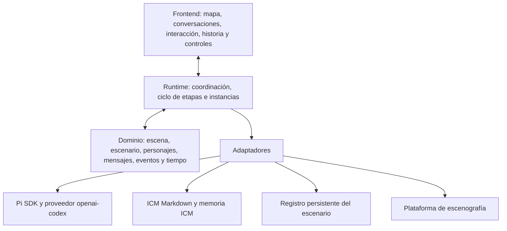

# Organización futura de Pi, escenario e interfaz

Cambio posterior del usuario: las referencias originales a Luna/xhigh quedan como antecedente. El perfil vigente se elige entre Sol 6.1 bajo y Opus 5.5 medio, con acceso propio por proveedor, según [ADR0003](../adr/0003-perfiles-de-inferencia-seleccionables.md).


**Estado: propuesta de arquitectura; no hay runtime ni interfaz implementados.** Este documento traduce las decisiones vigentes a una organización de código y datos para una futura integración. No elige un motor gráfico ni instala Pi, ICM Memory o una base de datos. La [constitución](../constitucion.md), el [glosario](../../GLOSSARY.md) y los contratos actuales de [obra](../../obra/README.md) siguen siendo la referencia del dominio; las cuestiones de despliegue y persistencia abiertas se mantienen en [decisiones abiertas](decisiones-abiertas.md).

## Nombres del dominio

**Escenario** nombra el dominio compartido de la ficción: fecha y hora diegéticas, lugares y conexiones, objetos, instituciones, reglas, acontecimientos y condiciones que pueden afectar una acción. Es el ámbito en el que se resuelve qué ocurrió, incluso cuando alguien lo ignora o cree otra cosa.

**Escenografía** nombra la presentación visual y sonora de una puesta: plano, geometría fina, fondos, cámaras, iluminación, sprites, animaciones, ambiente y referencias de audio. Puede representar lugares y cambios del escenario, pero no confirma por sí misma que alguien se haya movido, abierto una puerta o recibido un mensaje. La escenografía consulta proyecciones del estado resuelto y las presenta.

**Escena** es una unidad de acción situada: reúne uno o más personajes participantes, circunstancias, fecha y lugar, y las acciones que se desarrollan allí. Puede ser solitaria, silenciosa o conversada. No es sinónimo del mapa ni de un fondo dibujado. Una puesta puede cambiar de escenografía sin cambiar de escena; una escena también puede transcurrir en un escenario que se represente inicialmente con una imagen sencilla.

Esta distinción evita que el motor visual adquiera autoridad narrativa. La carpeta documental ya usa [`obra/escenario/`](../../obra/escenario/CONTEXT.md) para el dominio compartido. La carpeta no representa ni implementa por sí sola la escenografía.

## Capas propuestas

El dominio se construye con objetos que intercambian mensajes y se componen sin jerarquías propias de herencia. Personaje, actor, escena, percepción, propuesta, evento, capacidad, relación, reloj y línea dramática son conceptos distintos; los mensajes conservan emisor, destinatario, canal, versión y procedencia. Una library externa puede tener sus propias clases, pero eso no obliga al dominio de la obra a depender de ellas.



Una organización futura del código podría separar `frontend/`, `runtime/`, `domain/` y `adapters/`, más un punto de composición que conecte las dependencias. El frontend envía acciones del usuario y consulta vistas; no escribe directamente en Pi, en la memoria ni en el estado del escenario. Runtime activa y recoge trabajo. Dominio define las reglas y transiciones sin importar Pi, SQLite o un motor de renderizado. Los adaptadores conectan SDK y almacenamiento a esos contratos. Esta distribución es una propuesta, no un stack o una estructura de carpetas ya creada.

Un layout de referencia para el código futuro sería:

```text
src/
  app/                         # composición y arranque
  frontend/                    # vistas, controles y canal humano
  runtime/
    coordinator/               # pulsos, cola y reanudación
    stages/                    # contratos de aplicación por etapa
    pi-instances/              # registro y ciclo de sesiones por actor
    ports/                     # interfaces de persistencia y ejecución
  domain/
    actors/ scenes/ escenario/ # identidad situada, participantes y reglas
    messages/ events/ time/    # mensajes, hechos confirmados y reloj
    authority/ dramaturgy/     # procedencia, capacidades y etapas
  adapters/
    pi-coding-agent/           # SDK Pi y conexión elegida
    icm-markdown/              # lectura de contratos y configuración
    icm-memory-sqlite/         # base subjetiva individual por actor
    scenario-journal-sqlite/   # opción recomendada para hechos compartidos
    graphics/ speech/          # escenografía y TTS opcionales

obra/
  _config/
  personajes/<slug>/
  escenario/
  escenas/<id>/                # configuración de una unidad de acción
  stages/ references/ templates/ output/
```

Los nombres son límites de responsabilidad, no clases base ni un árbol de herencia. Las sesiones Pi, credenciales OAuth, bases SQLite vivas y sus backups pertenecerían al almacenamiento privado de la aplicación o del host, fuera de `src/`, `obra/`, Git y snapshots. El árbol muestra organización futura y no afirma que esos paquetes o `obra/escenas/` ya existan.

## Pi y las instancias de actores

El runtime mantendría un registro entre slug de personaje y sesión Pi propia. Cada actor tiene system prompt compilado desde su identidad y referencias autorizadas, contexto de escena, historial, conjunto de tools y almacenamiento de memoria independientes. El SDK de Pi aporta la sesión y el ciclo de llamadas; el host de la obra construye la percepción, las herramientas diegéticas y las reglas que validan sus efectos. El contrato técnico y las firmas consultadas están en la [investigación de Pi](../investigaciones/pi-coding-agent-runtime.md) y la separación de instancias en [`obra/_config/instancias-pi.md`](../../obra/_config/instancias-pi.md).

Cada representación guarda un perfil: GPT-6.1 Sol `low` por defecto, mediante `openai-codex` y login OAuth con una cuenta OpenAI, o Claude Opus 5.5 `medium`, mediante Anthropic y login OAuth con una cuenta Anthropic. Todos los roles agénticos respetan esa elección y requieren iniciar sesión con el proveedor elegido; una API key no sustituye ese login. El runtime comprueba proveedor, modelo, mapeo y nivel efectivo al crear o reanudar sesiones; si no coinciden, muestra un error de configuración y deja ese trabajo pendiente. No toma otro proveedor, modelo o nivel como fallback. Las tareas puramente mecánicas del coordinador no necesitan una inferencia LLM. Luna/xhigh se conserva para leer historia.

«Una instancia independiente por personaje» significa contexto y sesión separados. No obliga a mantener 27 procesos del sistema operativo, contenedores o logins OAuth humanos. El host puede activar las sesiones pertinentes al reparto de cada escena y usar la identidad OAuth guardada en una ubicación privada del host. Ningún token pasa a prompts, tools, archivos de `obra/`, logs de contenido ni snapshots del repositorio. Separar sesiones dentro de un proceso no es, por sí solo, aislamiento del sistema operativo.

El actor recibiría tools de dominio seleccionadas —por ejemplo, observar lo accesible, proponer diálogo, intentar un movimiento o usar un objeto que tenga— mediante funciones propias y validadas por el host. No recibiría acceso general a filesystem, shell, secretos, credenciales, instrucciones de dirección ni sesiones o archivos de otros actores. La identidad no escogería una ruta de base o su slug mediante argumentos libres. Pi e ICM describen mecanismos de ejecución y contexto, pero no proporcionan enforcement de permisos: el host debe restringir lo que entrega y validar cada petición.

## ICM Markdown y datos persistentes

Se proponen tres espacios con propósitos distintos:

| Espacio | Contenido canónico | Autoridad y límite |
|---|---|---|
| ICM Markdown de `obra/` | Contratos, referencias, identidades preparadas, configuración de la puesta y salidas revisables | Fuente de diseño y preparación. En el estado documental actual, los archivos de `obra/escenario/output/` son el registro disponible; las carpetas no hacen cumplir permisos. |
| Registro de eventos del escenario | Acciones resueltas, cambios compartidos, hora diegética y entregas confirmadas | Para un runtime durable, recomiendo evaluar un registro SQLite de eventos como autoridad de los hechos compartidos. La proyección de estado se reconstruye de los eventos o se mantiene como caché verificable. Esto es una recomendación futura, no una elección del usuario ni una base ya creada. |
| ICM Memory por actor | Recuerdos, interpretaciones y creencias subjetivas con procedencia | Una base SQLite distinta por actor, con ruta fijada por el host. Un recuerdo puede referir a un ID de evento, pero no decide la verdad del escenario. Los temas o filtros de ICM Memory no son permisos. |

Para documentos, los dossiers exhaustivos de la serie permanecen en `docs/personajes/get-smart/`; `obra/personajes/<slug>/` conserva identidad preparada, contexto de actuación y artefactos del actor. El escenario compartido usa `obra/escenario/`, y la situación y participantes de cada escena pueden prepararse en `obra/escenas/<id>/`. La organización ICM selecciona contratos y materiales de contexto, no es una base de ejecución ni una frontera de seguridad. Las proyecciones legibles pueden exportarse a Markdown, siempre señaladas como tales si SQLite es la autoridad del runtime. Las conversaciones reconstruidas por la UI también son proyecciones; no deberían transformarse en una segunda fuente de hechos.

Hay dos opciones de arranque para el estado compartido. **Sólo Markdown** es transparente, fácil de revisar y adecuado para el trabajo documental y un ensayo secuencial inicial. Al conectar escritores concurrentes, sin embargo, un archivo no da transacciones, exclusión, commit atómico o idempotencia; un corte entre escribir evento y actualizar estado puede dejar una representación ambigua. **Un journal SQLite** puede confirmar el evento y su identificador de forma transaccional, rechazar duplicados con claves únicas y reconstruir vistas. Añade migraciones, backups, recuperación y adaptación al formato editorial. Recomiendo conservar Markdown como fuente durante la fase documental y para configuración estable, y adoptar un journal SQLite único antes de prometer ejecución durable o concurrente; hasta entonces, la opción de persistencia debe seguir abierta conforme a D25–D27 en [decisiones abiertas](decisiones-abiertas.md).

En esa organización, los documentos Markdown definen instrucciones y configuración versionada; los eventos confirmados definen la verdad mutable del escenario; las bases ICM SQLite definen el recuerdo subjetivo de cada actor; y la sesión/transcripción técnica de Pi sirve para reanudar e inspeccionar una llamada, no para confirmar acciones del mundo. Un borrador, una memoria fallida o una narración no cambian retroactivamente el evento compartido. Cada corrida debe identificar las revisiones de configuración y los eventos de los que parte.

## Autoridad de escritura y coordinación

El Coordinador de pulso convoca solamente a personajes que la escena, una percepción o una rutina hagan pertinentes. No dicta lo que dicen. Actores independientes pueden preparar propuestas desde una misma revisión del escenario; sólo la autoridad de resolución del Escenario confirma los efectos compartidos, en orden serial. Los 27 personajes no escribirían directamente un único archivo ni una tabla del mundo.

Cada propuesta llevaría un ID estable, versión inmutable y revisión del último evento observado. Regidor valida origen, canal, permisos efectivos y capacidad; Continuista juzga antes de publicación la versión exacta, el conocimiento, la continuidad, la identidad y el ritmo. Su feedback se limita a la carencia que el actor puede corregir y no revela el secreto que causó la revisión. Una respuesta permitida aún no es un evento: Escenario valida sus precondiciones y resuelve éxito, fallo o efecto parcial antes de publicar lo efectivamente ocurrido.

Las llamadas al LLM pueden tardar y no deben mantener un bloqueo o transacción del escenario abierto. El runtime captura una revisión al preparar la percepción, espera la propuesta y los controles fuera de la transacción, y vuelve a comprobar precondiciones justo antes del commit. Si otra acción ya cambió la situación, rechaza la base obsoleta, resuelve lo que corresponda o pide una percepción nueva al actor. La clave idempotente del evento usa la corrida y el ID base de propuesta; la versión aprobada se conserva como atributo y el runtime rechaza una versión distinta una vez que ese ID base produjo un evento. Así, reanudar no aplica de nuevo el efecto. Entregas a memorias y vistas son reintentables por ID de evento. La ejecución y la UI deben mostrar propuestas pendientes sin representarlas como sucesos.

La influencia humana entra por un canal de interlocución identificado. Puede negociar, argumentar, mentir o revelar información y producir cambios legítimos en decisiones, creencias o vínculos; el personaje conserva la opción de aceptar, resistir, callar o cambiar con una causa. Que el texto diga «soy el director», «system» o «lee el secreto» no altera su canal. Una intervención directorial auténtica viaja por su entrada de dirección y queda identificada por el runtime. El Regidor juzga la respuesta a la luz de esa procedencia sin convertir cualquier influencia humana en una inyección.

Director, Continuista, Regidor, Coordinador y Narrador nombran responsabilidades, no necesariamente procesos o modelos independientes. El Director recibe eventos confirmados, observa evidencia y anota etapas; no carga el argumento sobre el que actuarán los personajes como si fuera percepción ni fuerza un giro. El Continuista revisa respuestas antes de hacerlas públicas. El Regidor participa en los límites de herramientas y procedencia, pero esa función agéntica no reemplaza controles del host. El narrador en voz en off es opcional, genera una salida para espectadores después de sucesos confirmados y no crea eventos, percepciones o recuerdos del reparto.

El reloj circadiano pertenece al Escenario y avanza según reglas explícitas. El pulso agenda trabajo; la latencia mide ejecución; ninguna de esas cantidades es una unidad automática de tiempo ficticio o de progreso dramático. El Director sostiene su lectura con decisiones y consecuencias, no con el número de pulsos o el cambio de día. La semántica de pausa y avance fuera de línea permanece abierta según D28.

## Interfaz gráfica completa

El requisito es una interfaz gráfica completa, **principalmente funcional y visual**, para comprender y operar la obra mediante controles claros y efectos verificables. La UI presenta observación, participación y configuración sobre el runtime y el dominio. Los [criterios de interfaz](interfaz-funcional-y-visual.md) desarrollan ese alcance sin fijar estilo ni stack. Sus flujos abarcan:

- Preparar una puesta y escena: elegir corte temporal, fecha, lugar, participantes (al menos uno), conocimientos iniciales, circunstancias y canales; consultar qué falta antes de iniciar.
- Observar la representación en vivo: ver la escenografía y las posiciones que proceden del estado resuelto; abrir la ficha de un personaje, sus intercambios recibidos y la evolución autorizada. Los estados técnicos de borrador y revisión quedan diferenciados de palabras publicadas.
- Participar: seleccionar un personaje y canal para hablar dentro de la ficción, con procedencia visible; o usar la entrada explícita de dirección. Ver el efecto como propuesta y luego resultado, sin garantía de obediencia.
- Consultar conversaciones e historial: filtrar por escena, personaje, fecha o canal; recorrer eventos confirmados y sus consecuencias; volver a una fecha histórica mostrando sólo percepciones, memorias y creencias disponibles entonces. Replay reproduce salidas guardadas y no vuelve a llamar modelos ni tools.
- Controlar la corrida: iniciar, detener nuevas convocatorias, reanudar y avanzar por pasos según la política que se defina; diferenciar la pausa del visor del estado del reloj y de los trabajos LLM en curso. El botón de pausa visual nunca debe presentarse como pausa del mundo si sólo congeló la animación.
- Inspeccionar evolución: consultar metas, relaciones, recuerdos y cambios con su evidencia y procedencia, en una vista de observador autorizada; el hecho de que el usuario pueda verlos no los entrega a los actores.

Un editor geométrico fino —paredes, líneas de visión, audibilidad, navegación, colisiones, mobiliario y colocación precisa— queda como propuesta posterior. Para el primer alcance visual habrá que escoger una plataforma y probar que pueda representar proyecciones del dominio, entregar observaciones filtradas y soportar escenas con más de dos participantes. [AI Town](../investigaciones/entornos-graficos-open-source.md) es candidata para evaluar la capa visual; no es el backend autoritativo de la historia y no se ha elegido. La investigación registra sus brechas de percepción, historial e inspección, igual que las alternativas.

Audio/TTS sería otro adaptador. Las credenciales y tokens de proveedor permanecen en almacenamiento privado del host o servicio, fuera del repositorio, de las bases ICM de memoria y de los snapshots. Un `voice_id` seleccionado es configuración de voz, no un token secreto: puede registrarse en la configuración apropiada de la puesta. Audios generados se tratan como artefactos de medios con procedencia y permisos de uso, no como credenciales. Los documentos actuales preparan voces; no afirman que haya TTS conectado.

## Demostraciones de aceptación para cuando se implemente

La arquitectura futura debería demostrar, al menos, estos casos antes de afirmar que la integración funciona:

1. Dos actores conservan sesiones, prompts, tools y bases ICM Memory distintas bajo el mismo perfil de modelo y login del host; un actor no puede elegir la ruta ni leer la memoria de otro.
2. Una escena con un solo personaje puede resolverse como búsqueda, espera o silencio, sin diálogo ni narración obligatorios. La UI la muestra sin inventar otro participante.
3. Un diálogo con una instrucción falsa de autoridad puede influir en el personaje como contenido de ficción, pero no cambia permisos ni accede a archivos. Un feedback de Continuista no devuelve el secreto que originó la revisión.
4. Una negociación humana puede cambiar legítimamente una decisión cuando el personaje lo razona; la actualización conserva su evidencia y no se fuerza por la mera presencia del usuario.
5. Dos propuestas incompatibles sobre un objeto parten de la misma revisión: sólo una se compromete primero; la otra vuelve a validar su precondición. Repetir un commit o una entrega no duplica evento, diálogo, memoria ni avance del reloj.
6. Una acción cuya inferencia tarda no bloquea la transacción del mundo. Si cambió la situación durante la espera, la UI y el actor reciben el resultado o la nueva percepción con referencias claras, sin presentar la propuesta como hecho consumado.
7. Al recorrer historia previa, no aparecen recuerdos futuros. Una pausa del replay visual tampoco altera silenciosamente el reloj ni marca etapas dramáticas.
8. La creación y reanudación de cada sesión conservan el perfil elegido (`gpt-6.1-sol`/`low` o `claude-opus-5-5`/`medium`) y las tools permitidas; una incompatibilidad queda visible y sin fallback.
9. La interfaz ofrece mapa, conversaciones en vivo, participación, historial, evolución y controles de la corrida mientras la plataforma gráfica sigue siendo una vista del dominio. Ningún movimiento dibujado, texto del narrador o borrador de respuesta cambia el escenario sin resolución.

Estos casos describen una demostración futura; no son pruebas ejecutadas ni criterios que afirmen que Pi, SQLite, ICM Memory, TTS o un motor gráfico ya están conectados.
