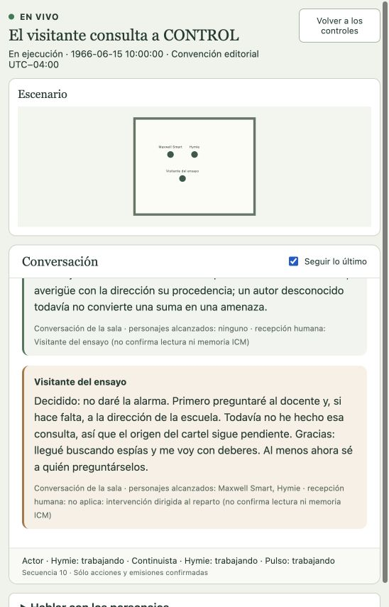
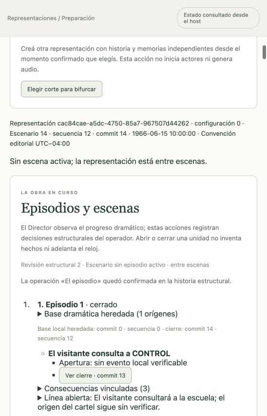

# CONTROL: el cartel sospechoso · función en vivo

Ensayo textual corto ejecutado íntegramente desde la interfaz el 16 de octubre de 2026 UTC (noche del 15 en Argentina). Representación `cac84cae-a5dc-4750-85a7-967507d44262`, host local 4182. Max y Hymie actuaron con sesiones Pi y memorias propias, OAuth OpenAI Codex y `gpt-6.1-sol`/`low`. El asistente interpretó al Visitante del ensayo; no se atribuyen sus intervenciones al usuario real. Audio apagado.

## Preparación e inicio gráficos

Se eligió la apertura de «El visitante y el aviso», commit 1, secuencia 0, anterior a sus diálogos. La GUI creó una continuidad independiente mediante operación `a21ae1cf-0fa0-4080-bae7-10238b961321`, sin copiar conversaciones ni recuerdos futuros. Escena y episodio se heredan como base local en commit 0: no se inventó un evento local de apertura.

Desde la misma GUI se reabrieron las memorias propias (`290f1ce6-6291-4228-af95-9b4a2a0f6833`), se renovó el sondeo de acceso y se completó el preflight `32d96a8c-2440-4add-a9f6-8b623b0adb3e`, comprobado a las 03:09:13 UTC. El botón **Iniciar** mostró el progreso y confirmó **En ejecución**. No se usó la API ni comandos para iniciar, intervenir, cerrar unidades o detener esta función.

El host había sido reiniciado ordenadamente para cargar el código v43 y la [corrección de controles](../auditoria/inicio-y-recuperacion-de-sesion.md). La configuración heredada conserva ausencia de selección ICM Markdown; esta función no acredita el recorrido de preparación nueva desde cero ni el uso de paquetes Markdown. ICM Memory SQLite sí estuvo disponible para los actores.

## Conversación confirmada

| Secuencia | Emisor | Intervención |
| --- | --- | --- |
| 1 | Hymie | ¿Podría indicarme la secuencia que desea examinar y dónde la observó? |
| 2 | Maxwell Smart | Maxwell Smart, agente 86 de CONTROL. Dígame qué ocurrió y qué observó usted personalmente. |
| 3 | Visitante | Agentes, vengo de la escuela de la esquina. En el tablón vi un cartel: «1, 1, 2, 3, 5, 8: continúe». Debajo decía «prueba de inteligencia». Temí que fuera una clave de KAOS. ¿Conviene dar la alarma o estoy convirtiendo la tarea escolar en un asunto de seguridad nacional? |
| 4 | Hymie | Cada número, desde el tercero, es la suma de los dos anteriores; siguiendo esa regla, vendría el 13. Por lo que usted describe, parece un ejercicio escolar, no fundamento para una alarma: convendría consultar a la escuela antes de atribuirlo a KAOS. |
| 5 | Maxwell Smart | No demos la alarma: por ahora tenemos indicios de una tarea escolar, no de KAOS. Consulte con la escuela quién puso el cartel; una «prueba de inteligencia» no necesariamente requiere agentes de inteligencia. |
| 6 | Maxwell Smart | La explicación de Hymie es razonable: no hay motivo para activar una alarma con lo que sabemos. Confirme con la escuela que se trata de un ejercicio; si encuentra una amenaza concreta, avísenos. |
| 7 | Visitante | Eso es lo que temo: si no aviso y resulta ser una amenaza, habré fallado; si movilizo a CONTROL por una tarea de matemáticas, quedaré como un tonto. Recuerdo que el cartel estaba junto al horario de la clase. ¿Qué hecho concreto tendría que comprobar primero para decidir sin inventar una emergencia? |
| 8 | Hymie | Compruebe primero con el docente si colocó ese cartel como ejercicio de la clase. Que estuviera junto al horario apoya esa explicación, pero no la confirma; por ahora, su relato no aporta un indicio concreto de amenaza. |
| 9 | Maxwell Smart | Primero pregunte al docente de esa clase si él colocó el cartel como ejercicio: ése es un hecho comprobable. Si no lo reconoce, averigüe con la dirección su procedencia; un autor desconocido todavía no convierte una suma en una amenaza. |
| 10 | Visitante | Decidido: no daré la alarma. Primero preguntaré al docente y, si hace falta, a la dirección de la escuela. Todavía no he hecho esa consulta, así que el origen del cartel sigue pendiente. Gracias: llegué buscando espías y me voy con deberes. Al menos ahora sé a quién preguntárselos. |
| 11 | Hymie | De nada: comprobar el origen del cartel es un paso razonable. Hasta entonces, tenemos una consulta pendiente, no una amenaza confirmada. |
| 12 | Maxwell Smart | Buen procedimiento: origen pendiente, alarma injustificada por ahora. Gracias por consultar; comprobar los hechos no lo hace quedar como un tonto. |

Las tres intervenciones del visitante alcanzaron a ambos actores. La intervención 4 de Hymie alcanzó a Smart y al visitante; las demás respuestas actorales acreditan recepción del visitante, sin recepción mutua atribuida retroactivamente. La recepción no equivale por sí sola a memoria ICM ni a lectura humana.

## Desenlace y cierre

El Director registró desarrollo suficiente y, antes de la decisión del visitante, desenlace insuficiente. Tras las intervenciones finales observó **desenlace con evidencia suficiente**, en commit 12: se resolvió la decisión de dar la alarma, no el origen del cartel. La consulta escolar sigue como intención.

La GUI cerró la escena en **commit 13** y el episodio en **commit 14**, secuencia **12**, revisión del Escenario **14**, revisión estructural **2**. El cierre vincula los eventos `37bdf622-1f40-4cc7-b9f8-1baf6a63d140`, `8a0a2830-6485-47fd-93c7-be9cb402a89c` y `d743aea8-2f2f-421b-92bb-b7e1f74f152f`. La línea «El visitante consultará a la escuela; el origen del cartel sigue sin verificar» cita la decisión del visitante.

Estado final **detenida**, sin escena ni episodio activos, **46 llamadas**, **198.602 ms** de transporte medido y **cero reservas activas**. Llamadas por representación, por pulso y tiempo acumulado estuvieron sin tope; el timeout individual siguió en 30 segundos. La historia permanece consultable.

## Alcance y fricción

Este ensayo acredita inicio, observación en vivo, interlocución y cierre de una función corta mediante la GUI con inferencia real. No acredita duración de episodio televisivo, audio, movimiento complejo ni calidad actoral integral. La repetición de la recomendación de Smart en las intervenciones 5–6 queda visible para evaluar ritmo y redundancia posteriormente.

Al cerrar, una descripción de línea abierta que excedía 120 caracteres fue rechazada antes de aplicar la operación. Se descartó ese intento sin efecto confirmado y se envió una descripción más breve con la evidencia conservada; el cierre quedó confirmado. No se sorteó esa validación. Para salir de la vista en vivo se usó «Volver a los controles»; un primer clic en la navegación superior no cambió la vista. No se presenta el recorrido como libre de toda fricción.

La prioridad siguiente sigue siendo facilitar este recorrido central y acreditar preparación nueva desde cero. La aceptación ampliada de importación/transferencia permanece fuera del camino crítico.
