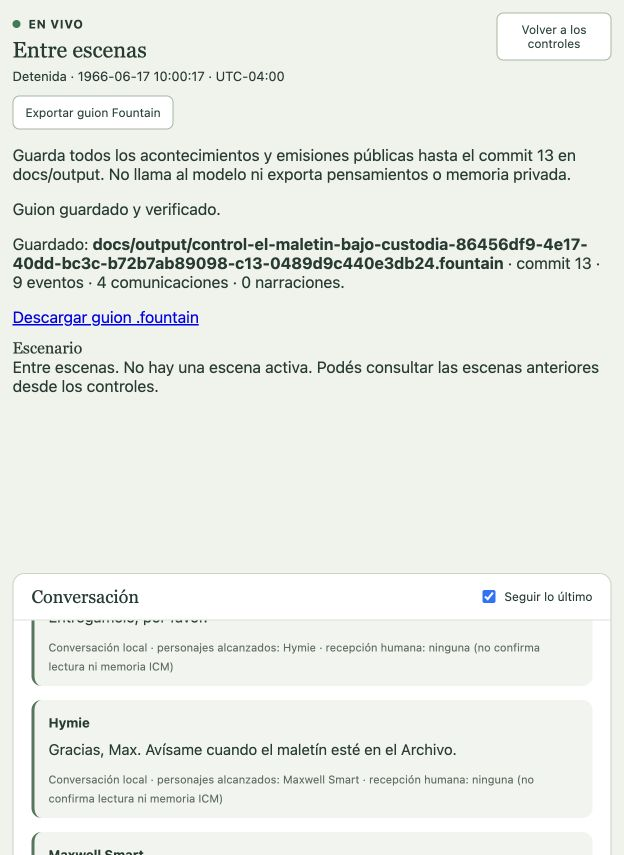

# CONTROL: el maletín bajo custodia

Puesta editorial sintética en Washington D. C., 17 de junio de 1966, 10:00 UTC−04:00. No es un episodio emitido ni hereda experiencias de los ensayos anteriores. Run `86456df9-4e17-40dd-bc3c-b72b7ab89098`, configuración Ready 3.

Max y Hymie tienen identidad, historia de vida curada en Markdown, deseos, metas, relaciones y memoria ICM SQLite independiente. Son adaptaciones acotadas con procedencia explícita, no biografías canónicas exhaustivas de los 27 personajes. El maletín empieza bajo custodia de Hymie en la sala de enlace. Max desea obtener una entrega voluntaria y transportarlo al Archivo; Hymie desea colaborar y ser tratado como compañero. El acuerdo y las acciones no están escritos de antemano. Hymie permanece en enlace; no se requiere acompañar a Max. No se presupone contenido secreto ni depósito o apertura del maletín.

Los dos lugares están unidos por conexiones de 2000 ms. No hay percepción entre salas: llegar al Archivo no informa automáticamente a Hymie. Canales locales de habla y gesto visual, narrador y audio desactivados, sin interlocutores humanos en esta puesta. Perfil OpenAI Codex OAuth, `gpt-6.1-sol`/`low`, instancias Pi separadas. Sin topes de llamadas ni tiempo acumulado; concurrencia uno y timeout individual 180000 ms.

## Preparación e inicio comprobados

La preparación se guardó por API autenticada y se revisó en GUI. Ready se confirmó por GUI sobre revisión 3. Memorias inicializadas por GUI: trabajo `4f15f8fe-bf3b-4cf8-9bb8-747cba345857`. Son bases iniciales vacías; la biografía no se presenta como una experiencia vivida registrada en memoria.

Sondeo real aprobado a las `2026-10-16T06:23:54.580Z`, con 25 tokens medidos. Preflight `b22ba411-0684-4e53-bdbf-9395f909d11b`, aprobado a las `2026-10-16T06:24:13.577Z`, 16 requisitos cumplidos. Inicio explícito por GUI y vista en vivo activa.

Primeras decisiones confirmadas: Hymie propone que Max traslade el maletín mientras él permanece en enlace; Max acepta y pide la entrega. Son emisiones del proveedor en ejecución, no diálogo añadido por el operador.

## Estado de la evidencia

La representación quedó detenida, con escena cerrada en commit 12 y episodio estructural cerrado en commit 13. Revisión del Escenario 12, estructura 3, secuencia 9, reloj 10:00:17.500 UTC−04:00. El registro conserva nueve eventos y cuatro parlamentos; no hubo intervenciones editoriales para dictarles respuestas o crear un medio de comunicación durante la actuación. Ledger: 57 llamadas, 215380 ms de transporte medido, sin reservas pendientes.

Hymie ofreció el maletín (commit 5), Max aceptó (6) y se trasladó al Archivo (8). La percepción propia del movimiento permitió otro trabajo en destino: Max observó (9), habló allí sin audiencia (10) y esperó (11). Su última frase reconoce el problema de avisar sin regresar con el maletín. Hymie no recibe ese monólogo ni adquiere conocimiento de la llegada por omnisciencia. El final es abierto: queda registrada la línea `aviso-de-llegada-a-hymie`, respaldada por la petición de Hymie y la última emisión de Max.

El Director reconoció planteamiento y desarrollo; consideró insuficiente la evidencia de desenlace. El cierre estructural fue una decisión explícita del operador y no modifica esa evaluación. Es un ensayo funcional breve cerrado, no aceptación de un episodio televisivo completo ni de calidad cómica integral.

[Guion Fountain](../output/control-el-maletin-bajo-custodia-86456df9-4e17-40dd-bc3c-b72b7ab89098-c13-0489d9c440e3db24.fountain), exportado desde la GUI: 1620 bytes, SHA-256 `0489d9c440e3db24367971831b0e25fbc475b626eda1ed3df932eb588a38f4e5`. Los cuatro parlamentos públicos se compararon literalmente con el DOM y aparecen exactamente una vez; sin Fibonacci. Las dos acciones de oferta se exportan con una descripción genérica de cambio de estado: falta distinguir mejor propuesta y aceptación en el texto escénico.

## Pendientes que expone la puesta

La transferencia y el movimiento funcionan, pero esta preparación no tiene un medio entre salas ni herramienta para dejar el objeto en un lugar. El siguiente trabajo debe completar esas posibilidades físicas y preparar una situación con resistencia dramática real, sin preescribir respuestas. No alcanza con agregar más parlamentos o cerrar una unidad estructural para acreditar un episodio completo. También sigue pendiente la curación exhaustiva de las biografías del reparto.

La corrección previa permite continuar desde el resultado propio de cuatro acciones físicas aplicadas, según [resultado privado y continuidad](../auditoria/resultado-privado-de-intentos.md). Verificación global antes de iniciar: 1479 pruebas, 1478 aprobadas, cero fallidas y una omitida; typecheck y build correctos. Las regresiones controladas no sustituyen la aceptación real de la puesta.
