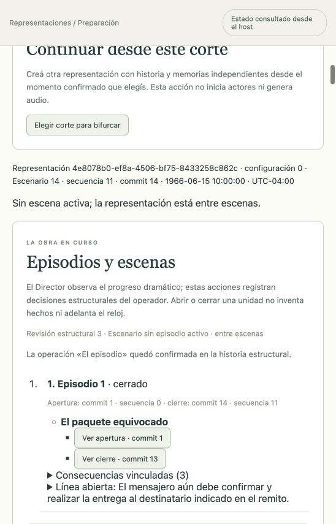

# CONTROL: El paquete equivocado

Función textual nueva solicitada sin Fibonacci, ejecutada el 16 de octubre de 2026 UTC. Max y Hymie atienden a un mensajero que confundió CONTROL con CONTROL DE PLAGAS. La aclaración del remito aparece durante la conversación, como testimonio del mensajero; no estaba anticipada como conocimiento de los actores. El asistente interpretó al mensajero, sin atribuir sus palabras o biografía al usuario.

**[Guion completo en formato Fountain](../output/control-el-paquete-equivocado-4e8078b0-ef8a-4506-bf75-8433258c862c-c14-2c27252d9e1585ad.fountain).** Exportado desde el botón de la aplicación: once emisiones confirmadas, portada, escena, nombres y diálogo, apertura/cierres y trazabilidad del corte. No contiene Fibonacci, pensamientos ni prompts privados. La descarga HTTP real coincide byte a byte con el archivo (2943 bytes, SHA-256 `2c27252d9e1585ad27c83cf8cddb2801ba7c599077c992c974f5a341747c6b3f`).

## Preparación y ejecución

Run `4e8078b0-ef8a-4506-bf75-8433258c862c`, configuración 0, continuidad nueva de adaptación y escena «El paquete equivocado» (`709a3b72-1322-417c-a3f8-16f451ecebc6`). Fecha ficticia: 15 de junio de 1966, 10:00 UTC−04:00; sala sintética de Washington D. C.; español latino editorial; audio/narrador desactivados. Perfil OpenAI Codex mediante login, `gpt-6.1-sol` / `low`; Pi y SQLite independientes para Max y Hymie.

Para acelerar el pedido, la preparación se creó y validó mediante la API existente, reutilizando exclusivamente los datos iniciales de preparación de la función anterior, no su snapshot vivido. Se recuran explícitamente situación, identidad situada/metas y procedencia; se conserva el expediente fuente y el snapshot ICM de nueve fuentes, hash `48fd6caccd735798cb64b94e903b25ff1de17fd370ef72b127ce7ab08541c3ae`. Estado inicial: secuencia/revisión 0, sin experiencias, creencias ni historias de metas vividas; memorias iniciales `none`. No es un fork ni una importación de conversaciones. El giro del destinatario no se sembró en el reparto. El paquete no se creó como objeto físico: sus descripciones son testimonios, y no se confirma una transferencia material por decirla.

Desde GUI: inicialización vacía de memorias (job `4dd6d0de-777b-43db-a657-745ba7a44b9a`), sondeo real aprobado a las 04:15:01.466 UTC, preflight `339eaaaf-f4e4-4c82-86c8-1860cca4501e` con dieciséis requisitos cumplidos a las 04:15:19.897, Iniciar, vista en vivo, tres intervenciones del mensajero, ocho respuestas actorales, cierre y detención. El sondeo de acceso es técnico y no una actuación.

## Desenlace y cierre

El Director reconoció desenlace suficiente en el commit 9 y lo reafirmó en el commit 12 (aceptado a las 04:20:45.237 UTC): el mensajero aclara su error, decide confirmar con López antes de entregar y se despide; los agentes responden. No da por realizadas la salida o la entrega. No se exige ni se inventa un clímax separado.

Escena cerrada en commit 13 y episodio en commit 14. Consecuencias vinculadas: decisión del mensajero `2da4a92b-e880-44d0-aa73-7e7e55dcef47` y despedidas `ff0c55cb-068c-462d-b599-7fca19dd240e`, `d8d49135-422c-4740-82ab-4768ba4a31d0`. Línea abierta: confirmar y realizar la entrega al destinatario del remito.

Estado final **detenida**, sin escena/episodio activo, Escenario 14, secuencia 11, commit 14. **40 llamadas medidas, 149.970 ms de transporte y cero reservas**. Llamadas/pulso/tiempo acumulado sin tope; concurrencia 1 y timeout por solicitud 30 segundos. El reloj ficticio permanece en 10:00:00 porque no hubo avances/esperas registrados; no es medición de la duración de lectura o representación teatral. Tras el cierre, el primer Detener encontró un CAS obsoleto; se actualizó estado y se confirmó la detención sin alterar la historia.

## Exportación comprobada

Después de detener, se cargó el exportador y se pulsó **Exportar guion Fountain** en la vista en vivo. Confirmó once eventos/comunicaciones y cero narraciones, guardó en `docs/output` y ofreció descarga. Las once réplicas del archivo se cotejaron con la conversación capturada de la interfaz, sin inferencia adicional. [Auditoría del exportador](../auditoria/exportacion-guion.md).

Es una función corta asistida y textual, no un episodio televisivo con audio ni una certificación integral de fidelidad/ritmo del corpus.
