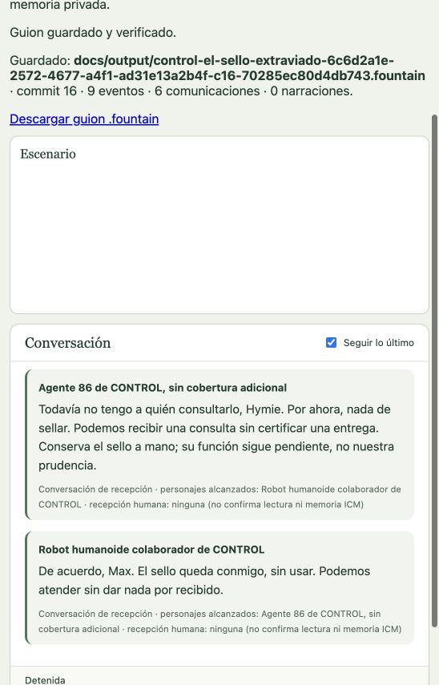

# CONTROL: el sello extraviado

Representación sintética, sin Fibonacci, iniciada el 16 de octubre de 2026. Escenario: recepción de CONTROL en Washington D. C., 16 de junio de 1966, 10:00 UTC−04:00. No se atribuye a un episodio emitido.

Run `6c6d2a1e-2572-4677-a4f1-ad31e13a2b4f`, configuración 4. Max y Hymie cuentan con identidad, historia de vida curada, dos deseos y dos metas cada uno, voz, relaciones, herramientas y memoria privada SQLite independiente. La historia se limita a las circunstancias admitidas de esta adaptación; no es una biografía canónica exhaustiva. No hay experiencias heredadas ni interlocutores humanos en esta puesta. Narrador y audio desactivados. Perfil OpenAI Codex OAuth, Sol 6.1 low.

La curación editorial está explicada en [biografía encarnada](../auditoria/biografia-encarnada.md). Los trabajos automáticos fallidos se conservaron como tales, sin aceptación ficticia. La preparación consumió seis llamadas y 447202 ms de transporte, conservados al pasar a Ready. Cuotas acumuladas de llamadas y tiempo ilimitadas; concurrencia uno y timeout individual de 180000 ms.

## Inicio verificado

- Ready confirmado por GUI sobre revisión 4.
- Memorias inicializadas por GUI: trabajo `1e74e304-7e35-4ded-ab27-2f997ff61d35`.
- Preflight `01f95456-6f62-4cac-b31a-cc2addbe1add`, aprobado a las `2026-10-16T05:42:26.471Z`, 16 requisitos cumplidos.
- Inicio explícito por GUI y vista en vivo activa. Primeras emisiones: Hymie pregunta qué debe certificar el sello; Max pregunta si su inscripción puede aclararlo. Son emisiones confirmadas de los actores, no diálogo escrito de antemano.

Estado final de este ensayo: detenido, con escena y episodio cerrados; guion exportado. Es una escena breve con acuerdo provisional, no aceptación de un episodio televisivo completo ni de calidad cómica integral.

## Hallazgo durante la actuación

Después de dos parlamentos, Max y Hymie propusieron observar visualmente el sello. Las dos acciones fueron aplicadas y quedaron registradas en los commits 4 y 5, sin eventos públicos ni avance temporal (`observeMs: 0`). Los jobs actorales y del Continuista terminaron aceptados. La representación quedó sin trabajo activo en secuencia 2: faltaba una continuación que permitiera al actor utilizar el resultado de su observación. Los primeros intentos de pausa apuntaron a controles cubiertos por la vista completa; la pausa se confirmó mediante la API autenticada. Se verificó después el flujo correcto: «Volver a los controles» y luego «Pausar» confirmó la pausa por GUI. No se acredita un fallo del control de pausa a partir de esos intentos cubiertos. No se presenta esta pausa como un desenlace.

La corrección de `commitWorldAttempt` crea intención durable para la percepción `observation` propia. Prueba integral: observación aplicada sin eventos ni avance de secuencia, cierre, reapertura, replay, entrega y nuevo pulso con la misma percepción. Focales: journal 43/43, supervisor 5/5, typecheck aprobado. No se rellenaron intenciones históricas.

Para continuar esta función, se registró una metaindicación administrativa explícita, operación `5adaeb14-d841-5e4d-9941-411a2a9ee65a`, revisión de dirección 1. Pide a cada actor continuar desde su propia observación sin aportar información nueva ni fijar respuesta o desenlace. No se presenta esta intervención como un acontecimiento de la ficción.

## Continuación y cierre verificados

La metaindicación no despierta por sí sola al actor: contextualiza trabajo elegible. Para generar una causa nueva se aplicó por Dirección el aumento de iluminación a `bright`, operación `437ef71d-c19a-5cd3-a1cf-c3f7ee8fc97b`, revisión de Dirección 2, commit 6/secuencia 3, recibida por ambos actores. Este estímulo es una intervención editorial explícita y se conserva como evento público.

Hymie tomó el sello (commit 7), volvió a observarlo (commit 10) y continuó con una emisión (commit 11). La percepción propia de esa observación aparece como input consumido de un job aceptado: la corrección quedó probada también en este recorrido real. Max decidió atender consultas sin certificar una entrega y Hymie aceptó conservar el sello sin usar. El remito permaneció en blanco.

El Director siguió calificando como insuficiente la evidencia de un clímax; el acuerdo es provisional y la función del sello continúa abierta. No se declara un clímax ni desenlace plenamente reconocido por el Director. La dirección humana cerró expresamente este ensayo breve: escena en commit 15, episodio en commit 16; estructura 3. Estado final `stopped`, revisión de Escenario 12, secuencia 9, reloj 10:00:07.500 UTC−04:00.

[Guion Fountain completo](../output/control-el-sello-extraviado-6c6d2a1e-2572-4677-a4f1-ad31e13a2b4f-c16-70285ec80d4db743.fountain): 2219 bytes, SHA-256 `70285ec80d4db743a10cb2aa16cb7b7117054367e56417fed308ad1725b6deaa`. Se compararon literalmente sus seis parlamentos contra el DOM público; los seis aparecen exactamente una vez. La exportación GUI conserva la iluminación, toma y espera confirmadas, y los cortes de apertura/cierre.

## Brechas detectadas

- La última propuesta de Max fue un gesto de asentimiento enviado por un canal de habla: resolución `notApplied`, `channel-kind-mismatch`, commit 14. No aparece falsamente como realizado en el guion. Hay que mejorar configuración/selección de canales y la continuidad desde intentos no aplicados; hoy esa consecuencia puede no despertar al actor.
- El ritmo es el de un ensayo breve, no el de un episodio de televisión acreditado; falta evaluar agencia y comicidad más amplias. La biografía sigue siendo una adaptación reducida, no la curación exhaustiva de los 27 personajes.
- Regresión completa: `TMPDIR=/private/tmp PERSONAJES_ICM_TEST_BINARY=/Users/andrestobelem/.local/bin/personajes-icm-0.11.4 npm run verify`: 1472 pruebas, 1471 aprobadas, 0 fallidas, 1 omitida. El primer intento con el TMPDIR de macOS bajo `/var` encontró rechazos de rutas temporales no canónicas; se mantuvieron las protecciones y se repitió con ruta canónica. Log `/private/tmp/personajes-observe-continuation-canonical-verify.log`.
