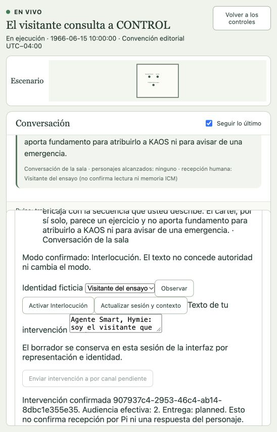
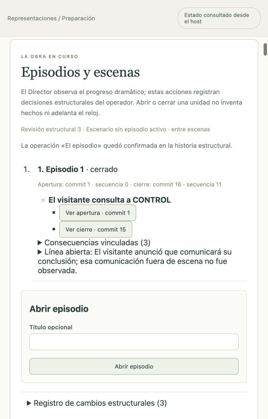

# El visitante y el aviso · prueba real de recepción dirigida

Ejecutada el 15 de octubre de 2026, hora local del host. Representación `5c94e829-ceb5-4568-a1ed-6b553c717386`, configuración 0. Fecha ficticia: 15 de junio de 1966 a las 10:00, UTC−04:00. Sala sintética de ensayo en Washington D. C.; adaptación declarada, no episodio canónico.

Se reutilizó únicamente la preparación original de Max/Hymie, sin copiar acontecimientos vividos, sesiones Pi ni recuerdos del ensayo anterior. Cada actor tiene sesión y base ICM propias. Perfil real: login OAuth OpenAI Codex, `gpt-6.1-sol`, esfuerzo `low`. Audio apagado. Llamadas por corrida/pulso y tiempo acumulado sin tope; timeout de solicitud 30 segundos y concurrencia 1. El sondeo de acceso vigente pasó antes de iniciar.

## Transcript confirmado

| Secuencia / commit | Emisor y audiencia efectiva | Intervención |
| --- | --- | --- |
| 1 / 2 | Hymie → Visitante del ensayo | ¿Puede indicarme la secuencia que desea examinar y dónde la observó? Necesito esos datos antes de evaluar si hay motivo de alarma. |
| 2 / 3 | Visitante del ensayo → Maxwell Smart, Hymie | Agente Smart, Hymie: soy el visitante que está frente a ustedes. Vi un cartel que dice «Ejercicio: complete los dos números siguientes: 1, 1, 2, 3, 5, 8». Me inquieta que sea una señal de KAOS. ¿Pueden explicármelo a mí y decirme si corresponde avisar de una emergencia? |
| 3 / 4 | Hymie → Visitante del ensayo | Si sumamos los dos números anteriores para obtener cada nuevo término, siguen 13 y 21: esa regla encaja con la secuencia que usted describe. El cartel, por sí solo, parece un ejercicio y no aporta fundamento para atribuirlo a KAOS ni para avisar de una emergencia. |
| 4 / 5 | Maxwell Smart → Hymie, Visitante del ensayo | Por lo que usted describe, parece un ejercicio, no motivo para declarar una emergencia de KAOS. Hymie, ¿puedes comprobar la regla de esos números y explicársela al visitante? |
| 5 / 6 | Maxwell Smart → Hymie, Visitante del ensayo | El cartel se presenta como un ejercicio; por sí solo no justifica declarar una emergencia. Hymie, comprueba la secuencia; señor, ¿vio alguna amenaza además de esos números? |
| 6 / 7 | Hymie → Maxwell Smart, Visitante del ensayo | Sí, Max: la regla encaja, porque 1 más 1 da 2, 1 más 2 da 3, 2 más 3 da 5 y 3 más 5 da 8. Siguiendo esa regla, señor, los siguientes son 13 y 21; eso explica los números, pero no demuestra ninguna relación con KAOS. |
| 7 / 8 | Visitante del ensayo → Maxwell Smart, Hymie | No, agente Smart: no había ninguna amenaza ni otro indicio. Gracias a los dos; entendí la regla y las respuestas 13 y 21. Comunicaré que el cartel, tal como lo vi, no justifica declarar una emergencia. |
| 8 / 9 | Hymie → Visitante del ensayo | De nada, señor. Su conclusión corresponde a lo que nos ha contado: sin amenazas ni otros indicios, ese cartel no justifica declarar una emergencia. |
| 9 / 10 | Maxwell Smart → Hymie, Visitante del ensayo | Correcto, señor: con lo que nos informa, no corresponde declarar una emergencia; si aparece una amenaza concreta, avísenos. Gracias, Hymie: una buena comprobación evita una mala alarma. |
| 10 / 12 | Maxwell Smart → Visitante del ensayo | De acuerdo, señor: sin amenazas ni otros indicios, no corresponde activar una emergencia por ese cartel. Si aparece algo nuevo, avísenos; CONTROL sabrá escucharlo. |
| 11 / 13 | Hymie → Maxwell Smart | De nada, Max. En este caso bastó con comprobar las sumas y preguntar por los otros indicios. |

La intervención humana se confirmó con receipt `907937c4-2953-46c4-ab14-8dbc1e355e35`. Los eventos actorales son `43f1d395-074f-46b8-b619-4df4a96dab95` y `afde4984-c1f2-4754-a0b7-ecb1b5a074a0`; en ambos coinciden audiencia humana solicitada y efectiva. Las audiencias de personajes están vacías. La bandeja del visitante mostró las dos emisiones. Las únicas percepciones privadas de este corte son las entregadas a Max y Hymie por la consulta humana; la recepción del visitante no produce entrega ICM.

## Estado y límites

En un corte inicial se detuvo temporalmente la representación conservando tres eventos y el commit 4. El ledger mostró 13 llamadas y 47.915 ms medidos, sin reservas ni solicitudes inciertas. No se declaró cierre de escena/episodio ni metas privadas alcanzadas.

El trabajo inicial de Max y su revisión del Continuista quedaron bloqueados con `execution-failed`; ese código genérico no demuestra la causa subyacente. Se pausó, se comprobó el corte actual y se usó «Reanudar y reintentar actores bloqueados». El lifecycle volvió a running, pero Max permaneció en generación 0, sin nueva llamada. La inspección de sólo lectura confirmó que su job no tenía filas de inbox: la recuperación vigente seleccionaba exclusivamente jobs con inputs liberados. La corrección posterior y su resultado se registran a continuación.

La captura corresponde al build que rotulaba la emisión humana actual como «recepción humana: sin registro histórico». Se corrigió después su presentación a «No aplica: intervención dirigida al reparto»; no se modificó el evento. El rótulo de ausencia histórica permanece para mensajes actorales antiguos sin audiencia humana registrada.

Este ensayo acredita recepción humana dirigida con proveedor real y GUI, no la aceptación integral del reparto, de una obra completa, del ritmo de Get Smart ni de audio/Anthropic. Los datos privados durables siguen en el host; Git conserva esta evidencia, no sus memorias ni el login.

## Recuperación y cierre posteriores

Se migró el host a journal v42, después de cerrar servicios y conservar una copia privada del journal previo. También se comprobó una reapertura posterior del host ya migrado. Los eventos confirmados conservaron sus IDs y contenido.

«Reanudar y reintentar actores bloqueados» creó la generación 1 del mismo job inicial de Max; la generación 0 permaneció bloqueada. El pulso humano `0020baff-5097-4549-b0cc-ac30b2555058` se apartó con dependencia explícita de la activación `7c26c927-e56f-4ee9-a5dd-230804c3e99f`. Tras aceptar a Max, la activación y ese mismo pulso humano terminaron `completed`, con el marcador limpio. El testimonio pendiente pasó a un job propio de su causa, sin agregarse al inbox de la activación inicial ni repetir el evento aceptado de Hymie.

Más tarde el Continuista de Hymie terminó sin respuesta completa. El nuevo código durable `pi-incomplete` apareció en los controles y el diagnóstico técnico identificó la etapa `terminal`; no se expuso contenido privado ni se atribuyó el fallo a una decisión del personaje. Se pausó, se comprobó el corte actual y se recuperó explícitamente la nueva generación. Esa recuperación también produjo una respuesta confirmada. No se afirma cuál fue la causa interna del terminal incompleto.

El visitante confirmó que no observó amenazas y que entendió la explicación. Se registró el cierre de escena en commit **15**, el del episodio en commit **16**, ambos con secuencia **11**. El cierre vincula tres consecuencias —confirmación del visitante y respuestas de los agentes— y conserva la línea «El visitante anunció que comunicará su conclusión; esa comunicación fuera de escena no fue observada». No se marcaron metas privadas como alcanzadas.

Estado final: **detenida**, revisión de mundo **14**, **11** intervenciones públicas, **66** llamadas y **258.303 ms** de transporte medidos; cero reservas activas. Este cierre estructural del ensayo no acredita aceptación dramática, actoral o audiovisual integral del producto.

La vista responsive se verificó en 548 × 855 con Interlocución expandida: el diálogo termina antes del panel, sin solapamiento. El footer distingue representación detenida de registros técnicos que aún conserven estado `running`. La bandeja conserva recepciones después del cierre; las emisiones humanas muestran «no aplica» para audiencia humana, en lugar de presentarse como historia faltante.
