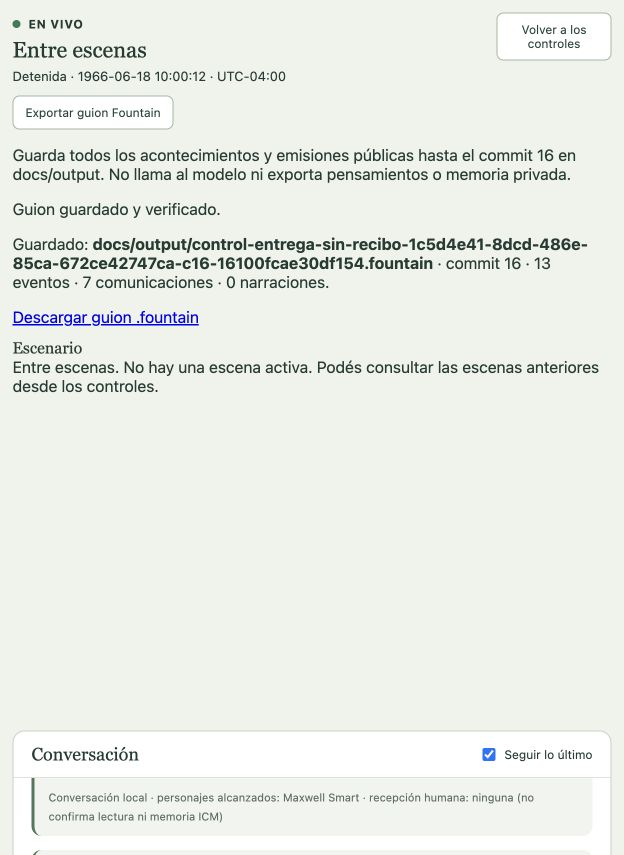

# CONTROL: entrega sin recibo

Puesta editorial sintética en Washington D. C., 18 de junio de 1966, 10:00 UTC−04:00. Run `1c5d4e41-8dcd-486e-85ca-672ce42747ca`, configuración Ready 1. No corresponde a un episodio emitido ni hereda experiencias del ensayo del maletín.

Max y Hymie conservan identidad, biografía curada, deseos, metas, relaciones y memorias SQLite independientes. Sus narrativas biográficas contienen 3099 y 3063 bytes respectivamente, con vacíos documentales conservados; la longitud no acredita exhaustividad canónica. La situación y sus tensiones se declaran adaptaciones. Max quiere completar el traslado, dejar el maletín cerrado en Archivo y volver con noticia; Hymie quiere responsabilidad clara y trato de compañero. Los medios y las respuestas siguen siendo decisiones del reparto.

Dos salas, conexiones de 2000 ms, habla y gesto locales; sin percepción entre salas, teléfono ni intercomunicador inventados. La nueva capacidad explícita permite [dejar el objeto propio](../auditoria/dejar-objetos-y-acotaciones.md); no se requiere una aceptación ajena para situarlo en el suelo. No hay contenido secreto establecido ni se exige abrirlo. No se fijan diálogo, número de turnos o resultado. Narrador y audio desactivados, sin interlocutores humanos en esta puesta.

Perfil OpenAI Codex OAuth, `gpt-6.1-sol`/`low`, Pi independiente por actor. Sin topes de llamadas ni tiempo acumulado; concurrencia uno y timeout individual de 180000 ms. ICM Markdown admitido por audiencias, distinto de memoria ICM SQLite.

## Inicio comprobado

Preparación manual editorial guardada por API autenticada, luego abierta y promovida Ready por GUI. Memorias iniciales vacías preparadas por GUI: `2ab4ba5a-1f6f-4b0e-842d-aca12efac8a2`.

Sondeo real aprobado a las `2026-10-16T06:42:42.402Z`, 25 tokens medidos. Preflight `f973b1cd-bf79-4a15-b637-daf361a3da81`, aprobado a las `2026-10-16T06:43:11.320Z`, 16 requisitos cumplidos. Inicio explícito por GUI y vista en vivo solicitada.

## Resolución y cierre comprobados

Hymie pidió responsabilidad explícita antes de la entrega. Max asumió el compromiso, aceptó el maletín (commit 6), fue al Archivo (8), lo dejó allí (9), regresó sin él (10) y avisó a Hymie (11). Hymie reconoció el cumplimiento (12), Max reconoció el trabajo de ambos (13) y Hymie asintió por el canal gestual (14). Son seis parlamentos y un gesto del proveedor, sin diálogos escritos por el operador durante la función.

El Director registró evidencia suficiente de desenlace operativo en commit 11 y la amplió con el reconocimiento recíproco y el gesto en commits 13–14. No impuso un clímax. Conservó una pregunta: que el maletín quedó cerrado es una afirmación de Max, sin comprobación independiente tipada de ese estado. El depósito, el regreso, el aviso y el reconocimiento sí están respaldados por acontecimientos públicos.

La percepción propia del depósito `299a60ca-b555-4773-b476-a0ba5d5a0660`, vinculada al evento `8826d7a8-e384-416b-b350-dc9b3c0b1e59`, quedó entregada y consumida por un turno aceptado de Max. Su Experience `74fe4bfc-a316-4f88-acf1-76c9df995e8b` tiene recibo ICM `projected`. La consulta fue SQLite de sólo lectura. Hymie no recibió esa percepción desde la otra sala: recibió el aviso posterior como comunicación.

La dirección humana pausó después del reconocimiento. La pausa dejó un job `job-inactive` de una época anterior y una solicitud de transporte ambigua. Al corregir el guard estructural se conservó esa incertidumbre y la negativa idempotente anterior, sin reanudar actores ni aceptar un resultado cancelado. Una operación nueva cerró la escena desde la GUI en commit 15, y el episodio en commit 16 con seis consecuencias vinculadas. Se detuvo la representación sin usar el cierre irreversible de la corrida.

Estado final `stopped`, Escenario 16, estructura 3, secuencia 13, reloj 10:00:12.500 UTC−04:00. Ledger: 75 solicitudes contabilizadas, 291761 ms medidos, cero reservas pendientes. Se conservan 74 solicitudes completadas y una ambigua; el ledger no acredita costo monetario ni permite dar por confirmado el resultado interrumpido. No hubo inferencias para corregir la vista, cerrar o exportar.

## Guion y pantalla

[Guion Fountain completo](../output/control-entrega-sin-recibo-1c5d4e41-8dcd-486e-85ca-672ce42747ca-c16-16100fcae30df154.fountain): 1985 bytes, SHA-256 `16100fcae30df15408fb9f6488ca57f22e0a7ae205e17b47cfc184f34794f12a`. Exportado por GUI con trece eventos, siete comunicaciones y ninguna narración. Los seis parlamentos coinciden literalmente, una vez cada uno, con el DOM público; el gesto se conserva como acotación «Hymie asiente». No hay Fibonacci, pensamientos privados ni un contenido inventado para el maletín. Oferta, aceptación y depósito se distinguen en sus acotaciones.

La pantalla angosta expuso un plano contraído a cero por las conexiones. Se corrigió la distribución y se verificó una altura visible de 180 px. La captura muestra el objeto en Archivo después del regreso de Max, con la función en pausa:

## Alcance de la aceptación

Se acredita un recorrido funcional de principio a fin: acuerdo, transferencia, desplazamiento, depósito, regreso, comunicación, reconocimiento, cierre y exportación. Es una escena breve con resolución operativa, no aceptación del ritmo, duración o calidad de un episodio televisivo completo. Sigue pendiente una situación con mayor resistencia dramática y evolución observable, la curación exhaustiva del reparto y el resto de los 77 requisitos integrales.

Verificación final tras las correcciones: **1487 pruebas, 1486 aprobadas, cero fallidas y una omitida**; typecheck, build y control de formato correctos. Log local `/private/tmp/personajes-putdown-closure-final-verify.log`. [Contrato, regresiones y límites de las correcciones](../auditoria/dejar-objetos-y-acotaciones.md).
