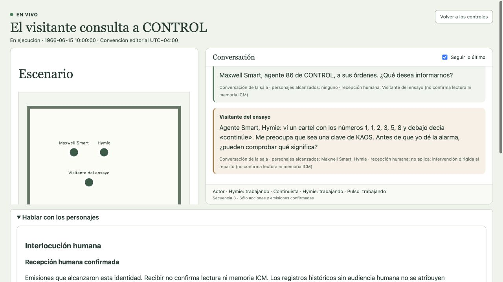
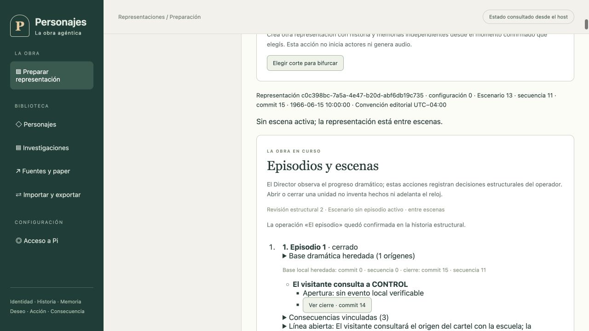

# CONTROL: la alarma de los números · función completa

Ensayo textual corto ejecutado del principio del diálogo al cierre del episodio el 15 de octubre de 2026, hora de Argentina. Representación `c0c398bc-7a5a-4e47-b20d-abf6db19c735`. Max y Hymie usaron instancias Pi, sesiones y memorias propias, con OAuth OpenAI Codex y `gpt-6.1-sol`/`low`. El asistente interpretó al Visitante del ensayo; sus intervenciones no se atribuyen al usuario real. Audio apagado.

La función parte del commit 1, secuencia 0, de [El visitante y el aviso](el-visitante-y-el-aviso.md): antes de sus diálogos. Se publicó una continuidad independiente, sin copiar respuestas ni recuerdos futuros. La escena/episodio inicial se heredan como base local en commit 0; no se inventó un evento local de apertura. El host habitual en 4182 conservó su runtime anterior. Esta ejecución no acredita ICM Markdown v43 ni el recorrido de preparación nueva desde cero.

## Desarrollo confirmado

| Secuencia | Emisor | Intervención |
| --- | --- | --- |
| 1 | Hymie | ¿Podría indicarme la secuencia que desea examinar y cómo la obtuvo? |
| 2 | Maxwell Smart | Maxwell Smart, agente 86 de CONTROL, a sus órdenes. ¿Qué desea informarnos? |
| 3 | Visitante | Agente Smart, Hymie: vi un cartel con los números 1, 1, 2, 3, 5, 8 y debajo decía «continúe». Me preocupa que sea una clave de KAOS. Antes de que yo dé la alarma, ¿pueden comprobar qué significa? |
| 4 | Hymie | Cada número después de los dos primeros es la suma de los dos anteriores; con esa regla seguiría 13, pero eso no demuestra una relación con KAOS. ¿Dónde estaba el cartel y había algún otro texto o símbolo? |
| 5 | Maxwell Smart | Por ahora no hay motivo suficiente para dar la alarma: una regla numérica no prueba que intervenga KAOS. ¿Dónde vio el cartel y recuerda alguna firma o símbolo que permita identificar su origen? |
| 6 | Visitante | Estaba en un tablón de la escuela. No tenía firma; sólo la frase «prueba de inteligencia». Si era un ejercicio y yo movilizo a CONTROL, voy a quedar bastante mal. Pero si no aviso y resulta ser una clave, peor. ¿Cómo salimos de esa duda? |
| 7 | Hymie | El lugar y la frase apoyan la hipótesis de un ejercicio, no una alarma: conviene preguntar a la escuela quién colocó el cartel y con qué propósito. Si nadie puede confirmarlo, quedará una duda por investigar, no una prueba de que intervenga KAOS. |
| 8 | Maxwell Smart | Seguiremos la recomendación de Hymie: consulte a la dirección de la escuela quién puso el cartel y para qué, sin dar la alarma. Si no lo aclaran, tráiganos la respuesta; investigar una duda no exige presentarla como una certeza. |
| 9 | Visitante | Tienen razón: con esos datos no hay base para acusar a KAOS. No daré la alarma; primero consultaré a la escuela. Si me preguntan, diré que fue una prueba de inteligencia… y que aprobé la parte de pedir ayuda. Gracias, agentes. |
| 10 | Hymie | De nada; pedir ayuda fue prudente. Hasta consultar a la escuela, sería más preciso decir que parece un ejercicio. |
| 11 | Maxwell Smart | A sus órdenes; consultar antes de dar la alarma fue una buena decisión. Sólo deje pendiente la calificación de esa prueba hasta que la escuela confirme de qué se trataba. |

El testimonio del visitante llegó a ambos actores. Las intervenciones 4 y 7 de Hymie alcanzaron también a Smart; las restantes respuestas actorales de este transcript alcanzaron al visitante, sin acreditar que las oyera el otro actor. La recepción y procedencia se comprobaron en la GUI.

## Cierre comprobado

El Director registró desarrollo y descartó proponer un clímax sin evidencia. Tras la decisión del visitante anotó **desenlace con evidencia suficiente**: la disyuntiva inmediata queda resuelta; el origen del cartel sigue sin confirmar. No se forzó una sucesión de etapas ni se inventó que la consulta escolar hubiera ocurrido.

Después de drenar los trabajos, el operador cerró la escena en commit **14** y el episodio en commit **15**, secuencia **11**, revisión del Escenario **13**, revisión estructural **2**. El cierre vincula la decisión del visitante y las dos respuestas finales, y conserva la línea «El visitante consultará el origen del cartel con la escuela; la consulta no fue observada» con evidencia de esa intención.

Estado final confirmado: **detenida**, sin episodio ni escena activos, **11 intervenciones**, **52 llamadas** y **233.926 ms** de transporte medido, sin reservas activas. Llamadas y tiempo acumulado estuvieron sin tope; el timeout por solicitud se mantuvo en 30 segundos. La historia sigue consultable en la pestaña de la función.

## Límites y fricción observada

Esto acredita un ensayo textual corto de principio a fin con inferencia real, observación en vivo, intervención, moderación y cierre durable. No equivale a un episodio televisivo de duración estándar, aceptación de calidad cómica/actoral integral, movimiento escénico complejo, audio o todos los requisitos del producto.

El primer preflight bloqueó el acceso porque el sondeo había vencido; renovarlo confirmó el perfil y permitió pasar todos los requisitos. La pestaña antigua falló al sincronizar controles tras cambiar de corrida. Una vista nueva leyó correctamente el estado; el inicio se confirmó mediante API autenticada después de verificar que seguía Ready, sin duplicar la operación. El resto del diálogo, cierre de escena, cierre de episodio y detención se operó desde la GUI. El problema del primer inicio requiere una reproducción y corrección específicas; este ensayo no se presenta como recorrido íntegramente gráfico sin fricción.

La prioridad indicada por el usuario es completar este recorrido principal. Importación/transferencia exhaustivas quedan fuera del camino crítico de la alpha.
