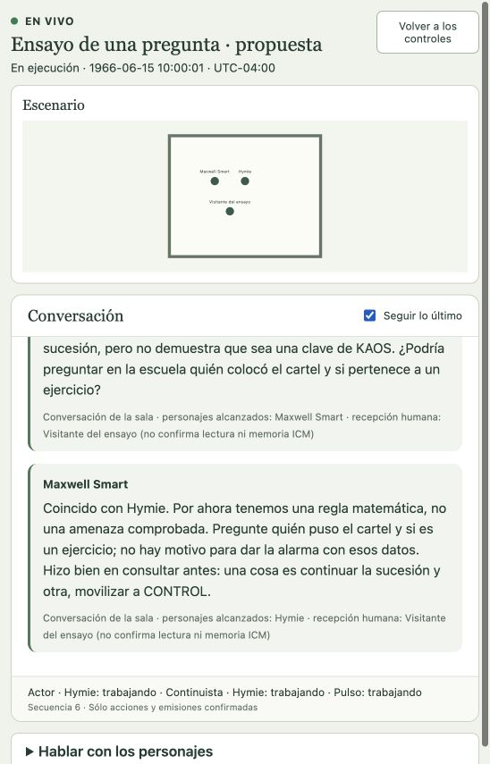
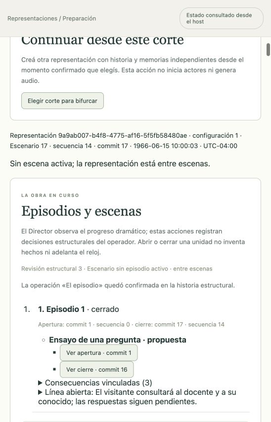

# CONTROL: una pregunta a tiempo · preparación nueva ICM

Transcripción de las emisiones confirmadas de la función nueva, capturada desde la vista en vivo el 16 de octubre de 2026 UTC. El asistente interpreta al Visitante del ensayo; no se atribuyen sus palabras al usuario real. Audio apagado.

## Conversación

El ordinal enumera intervenciones habladas; no es la secuencia de eventos del Escenario, que incluye también esperas.

| Intervención | Emisor | Texto |
| --- | --- | --- |
| 1 | Hymie | ¿Qué le gustaría comprobar? Podemos empezar por lo que usted haya observado. |
| 2 | Maxwell Smart | Maxwell Smart, agente 86 de CONTROL. ¿En qué puedo ayudarle? |
| 3 | Visitante del ensayo | Agente Smart, Hymie: ¿conocen eso que llaman algoritmo de Fibonacci? En la escuela vi un cartel con 1, 1, 2, 3, 5, 8 y «continúe». Un conocido dijo que era una clave; yo pensé en KAOS y vine a preguntar antes de dar la alarma. Sólo vi esos números, no una amenaza escrita. |
| 4 | Hymie | Sí. Esos números corresponden al inicio de la sucesión de Fibonacci: cada término es la suma de los dos anteriores. Siguiendo esa regla vienen 13, 21 y 34. Eso permite continuar la sucesión, pero no demuestra que sea una clave de KAOS. ¿Podría preguntar en la escuela quién colocó el cartel y si pertenece a un ejercicio? |
| 5 | Maxwell Smart | Coincido con Hymie. Por ahora tenemos una regla matemática, no una amenaza comprobada. Pregunte quién puso el cartel y si es un ejercicio; no hay motivo para dar la alarma con esos datos. Hizo bien en consultar antes: una cosa es continuar la sucesión y otra, movilizar a CONTROL. |
| 6 | Visitante del ensayo | Mi conocido insiste en que continuar esos números sería ayudar a descifrar una clave enemiga. No sé quién puso el cartel y temo equivocarme en cualquiera de los dos sentidos. ¿Qué tendría que comprobar para que una sospecha deje de ser sólo una conjetura? |
| 7 | Hymie | Entiendo su preocupación. Continuar una suma no demuestra que esté ayudando a un enemigo. Para sostener esa sospecha necesitaríamos un vínculo comprobable entre el cartel y una actividad hostil, no sólo números que también aparecen en una clase. Pregunte al docente si es un ejercicio y a su conocido qué observó exactamente para llamarlo clave enemiga. Luego podremos contrastar sus respuestas. No saber quién lo puso es una pregunta pendiente, no una prueba contra nadie. |
| 8 | Maxwell Smart | La insistencia de su conocido no cuenta como una segunda fuente. Pídale un dato que podamos verificar: qué vio, dónde y qué lo vincula con una actividad enemiga. Después hay que comprobarlo por separado. Si el docente confirma que es un ejercicio, eso explica el cartel; si aparece una amenaza concreta, comuníquela sin enfrentarse a nadie. Investigar no exige acusar primero. Aunque reconozco que eso ahorra bastante papeleo. |
| 9 | Visitante del ensayo | Entonces no voy a dar la alarma ni acusar a nadie. Consultaré al docente por el cartel y le pediré a mi conocido que diga qué observó realmente; todavía no hice esas consultas. Me llevo dos preguntas y ningún enemigo nuevo. Gracias, agentes: para mi primera visita a CONTROL, prefiero salir con deberes antes que con un expediente. |
| 10 | Hymie | Fue un gusto ayudarlo. Y esos deberes no tienen calificación: si una respuesta no queda clara, puede volver y la revisamos juntos. |
| 11 | Maxwell Smart | De nada. Cuando tenga las respuestas, podremos evaluar los hechos. Y no se preocupe: salir de CONTROL sin un enemigo nuevo también es un resultado satisfactorio. Buen día. |

## Preparación nueva y ejecución comprobada

Representación `9a9ab007-b4f8-4775-af16-5f5fb58480ae`, configuración 1. Se creó una preparación ordinaria nueva desde el preset editable Max/Hymie, sin bifurcar una historia anterior ni importar diálogos. Desde la GUI se curaron por separado identidad, habla, antecedentes, límites de conocimiento, deseo, capacidades, relación y experiencia inicial de cada actor; se confirmaron reparto, posiciones, reconocimiento y presencia del visitante. Los datos sintéticos son una adaptación, no canon ni biografía del usuario.

Circunstancias: 15 de junio de 1966 a las 10:00, UTC−04:00, sala sintética de Washington D. C.; español latino como elección editorial; reloj manual, audio y narrador apagados. El asistente interpretó al visitante y escribió sus tres intervenciones desde la GUI. Las ocho intervenciones de los actores fueron generadas por sus instancias Pi independientes con OpenAI Codex mediante login, `gpt-6.1-sol` / `low`.

Se seleccionaron explícitamente nueve fuentes y diecisiete secciones ICM por audiencia. Snapshot: `48fd6caccd735798cb64b94e903b25ff1de17fd370ef72b127ce7ab08541c3ae`. Actor: contrato de actuación y contexto propio; Continuista y Director: sus contratos separados; Configurador: su contrato. La selección de este último no acredita ejecución real de ese rol. El guardado, validación Ready, preparación de las SQLite independientes, sondeo, preflight, inicio, interlocución, cierre y detención se operaron mediante interfaz. No se usó API para suplir esos pasos.

Memoria inicial: job `d123141b-00de-4af1-b029-6b3441f2db9e`. Después del reinicio ordenado del host, el job `a88befb6-f85f-42e8-8ed7-56acabb0b057` reabrió las memorias existentes. El primer preflight reveló un error de proyección del gate ICM; se corrigió y el nuevo job `ca1be69d-3d62-4938-ac74-19582897599b` confirmó los dieciséis checks a las 03:40:56.754 UTC. Ver [auditoría de los cambios](../auditoria/preparacion-nueva-y-contexto-icm.md).

## Desenlace y cierre durable

El Director aceptó una observación de **desenlace con evidencia suficiente** sobre el commit 15, secuencia 14, a las 03:47:07.738 UTC. Interpretó que el visitante resolvía el dilema inmediato al decidir comprobar antes de alarmar; no afirmó que ya hubiera consultado las fuentes ni descartó toda amenaza. El operador cerró la escena en el commit 16 y el episodio en el commit 17, vinculando las tres comunicaciones finales como consecuencias.

Quedó abierta esta línea: «El visitante consultará al docente y a su conocido; las respuestas siguen pendientes». Evidencia: evento `64ec79ae-9fc9-4729-9ba3-2926969815c2`. Despedidas vinculadas: Hymie `344723cc-e43b-4f54-a64b-9bc06965891f` y Max `6c3108b3-9497-4817-8d6e-6f4db9aae00f`.

Estado final: **detenida**, episodio cerrado, sin escena activa; Escenario 17, secuencia 14, commit 17; reloj ficticio 10:00:03. Once emisiones habladas y tres esperas. **58 llamadas medidas, 241.783 ms de transporte, cero llamadas y cero tiempo reservados**. Llamadas por corrida/pulso y tiempo acumulado sin límite; concurrencia 1 y timeout por solicitud de 30 segundos. Los contadores no representan tokens ni costo monetario.

## Integridad y límites

Una inspección readonly de la SQLite privada verificó 29 paquetes: Hymie 5, Max 6, Continuista 11 y Director 7. Comprobó JSON canónico, checksums, audiencia/job/generación, revisión, cortes persistidos, contrato compilado y preparación propia. Los [metadatos de integridad](pregunta-a-tiempo-icm-integridad.json) no contienen prompts privados ni credenciales. No equivalen a aceptación integral de todas las relaciones entre jobs, sesiones y checkpoints, ni a una transferencia entre hosts.

Se acredita una función textual corta, con preparación nueva y contexto ICM real hasta el cierre. Falta Configurador anterior a Ready, inspección gráfica de paquetes, calibración de ritmo y fidelidad de personajes, audio y aceptación completa del producto. El Director no observó un clímax suficiente separado: no se inventa esa etapa para completar una plantilla. La preparación y la interlocución fueron asistidas; no se acredita una obra larga autónoma ni que el visitante fuera interpretado por el usuario.
