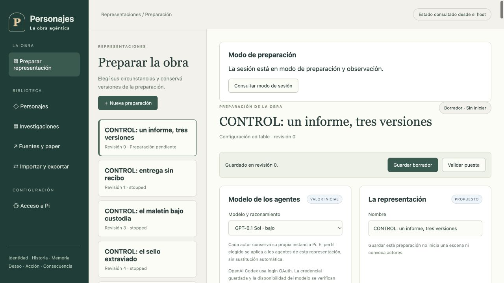
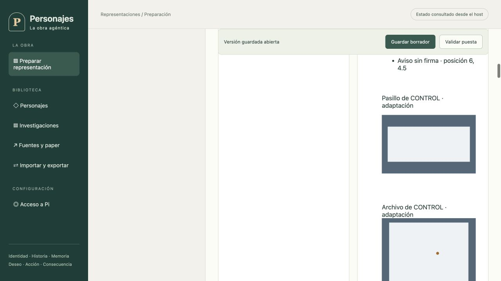

# CONTROL: un informe, tres versiones — preparación

Estado del 16 de octubre de 2026: **borrador guardado, no representación ejecutada**. Run local `803a8675-2ad0-47ed-9d76-c7f8a64743a1`, revisión 3. No se generaron diálogos, recuerdos ni un guion de esta puesta.

El selector ofrece una adaptación sin Fibonacci con Max, Agente 99 y el Jefe. Propone una oficina de CONTROL en Washington D. C., el 20 de junio de 1966 a las 09:00 UTC−04:00. Fecha, lugar, continuidad, reparto y conflicto siguen siendo propuestas editables. La revisión 3 amplía el Escenario a oficina, pasillo y Archivo, con cuatro conexiones transitables de 2000 ms y sin percepción entre salas. Permite separarse y buscar a otros sin una secuencia obligatoria de escenas. Hay dos documentos físicos. Uno es un aviso sin firma: «Prueba de alarma: resultado sin confirmar». Su existencia no prueba una alarma ni su causa. El otro, en el Archivo, es un registro sin fecha ni firma sobre un circuito desconectado para revisión; su texto tampoco prueba el estado actual del circuito ni quién escribió el aviso. No hay culpable, respuesta ni desenlace prefijados.

La política `embodied-v1` exige biografía y deseos completos para cada actor activo. El preset no prepara actores ni les adjudica recuerdos, conocimientos, herramientas o posiciones: el reparto guardado contiene tres identidades seleccionadas y cero contextos preparados. Las sugerencias de motivos se muestran sólo al operador. La curación posterior debe admitir por separado identidad, historia de vida, deseos, Goals y conocimiento situado.

Se ampliaron las fuentes curatoriales de [99](../personajes/get-smart/agente-99.md) y [el Jefe](../personajes/get-smart/jefe.md), distinguiendo evidencia de producción, hechos de la ficción e hipótesis actorales. El catálogo se versionó como `get-smart-original-1965-1970-2026-10-16.1`, con hashes exactos de ambos archivos. Esto no modifica las fuentes congeladas de representaciones anteriores ni convierte estos expedientes en biografías exhaustivas admitidas para 1966.

## Verificación

- Typecheck y build aprobados. Suite global: 1488 pruebas, 1487 aprobadas, cero fallidas y una omitida. Log local `/private/tmp/personajes-ensemble-verify.log`.
- Tras exigir `embodied-v1` en el preset, se repitieron typecheck, build y las ocho pruebas de presets y selector montado: todas aprobadas. Log `/private/tmp/personajes-ensemble-tests.log`.
- Navegador real: creación de la propuesta, exigencia explícita de biografía/deseos y guardado confirmado. Lectura SQLite independiente confirma reparto, cero contextos y política `embodied-v1`.
- En este borrador se configuraron llamadas y tiempo acumulado sin límite, concurrencia 1 y timeout por request de 300000 ms en la revisión 3 (antes 180000 ms). No se hicieron inferencias para crear el preset. Dos trabajos posteriores de curación se bloquearon: uno por acceso vencido, otro por timeout; ninguno entregó una propuesta aceptada. Ver [recuperación del Configurador](../auditoria/recuperacion-configurador-tras-timeout.md).

## Próximo paso

Curar los tres actores con el Configurador y revisión de fuentes, confirmar circunstancias, ubicar el reparto, seleccionar contratos ICM por audiencia, inicializar memorias y pasar validación/preflight. Luego ejecutar y observar el desarrollo hasta un desenlace sustentado, cerrar la estructura y exportar el guion real a `docs/output`. Nada de esto se acredita mediante el preset ni por estas pruebas. El objetivo integral continúa abierto.
